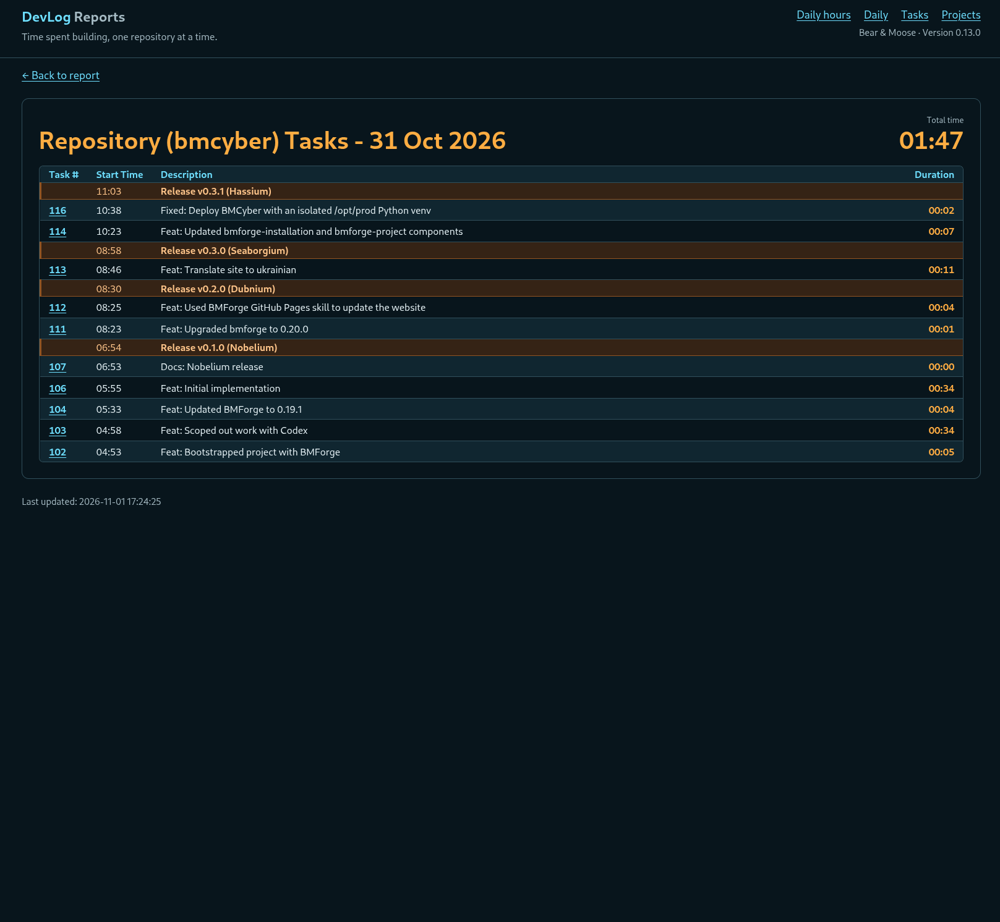

I created [DevLog](https://devlog.osoyalce.com) to help me track how much time I was spending on my open-source projects. I didn't want tons of fancy features, just basic stuff. This is what I came up with.

It's a client/server application that uses ZeroMQ for messaging. I issue a `dl start` command within a Git repository and a message is sent to the DevLog server. Once I've done the work I enter `dl commit` along with my Git log message and my changes are commited to Git and another message is sent to the DevLog server. I took it a step further and added a `dl publish` which basically cuts a git release (merges, features branches etc. etc.)

How people use git is very different, so this application is tailored to my personal work flow. The only thing that's new is the `dl start` command. I replaced my old `gitcommit` shortcut with `dl commit`. I wrapped my old `new-release.sh` script with a call to `dl publish`.

The app can easily be extended to add more reporting, but for now, it does everything I want. Here's a screenshot showing one day's work.

Here's a view that only shows one project.

Every now and then I'll forget to do a `dl start` so the timing is off. Similarly, I've forgotten to stop a running task (which happens automatically when you start a task in a different repo, or if you do a `dl pause`, or if you start a task in another repo). So I created a task editor as well, to allow me to edit the timing.

