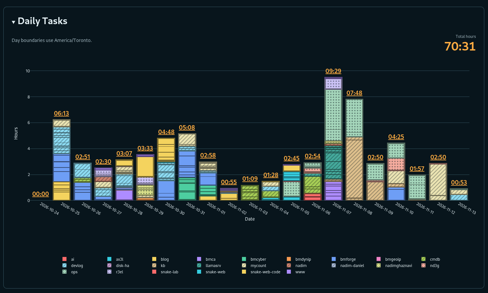

I thought I'd create a followup post on how the [DevLog](https://devlog.osoyalce.com) project is working out. I deployed and started using it almost three weeks ago. I have to say, I really love it! 



It not only gives me an overview of the hours I'm spending on my open-source projects. It also:

- It helps me pick up where I left off.
- I manage a life/work balance better.
- I can see where my time is going and what, if anything, is being produced.

One lesson learned. Some project work doesn't result in a GitHub commit. For example:

- Marketing posts
- Verification
- Creating a spec

I created an **Ops** repository to track such work. I used that bucket to track my rollout of [FreeIPA](https://kb.osoyalce.com/pages/FreeIPA/#add-a-fedora-machine-to-the-freeipa-domain) in my lab environment. It was a chunk of work and I wanted to see it in my DevLog hours.

I also did a minor tweak to the `dl status` output, so it shows paused tasks:

```
$ dl status
Repository (blog): Task #236 running for 00:17 (HH:MM)
Paused tasks:
  Repository (bmforge): Task #227 paused
$ 
```

All in all, I'm very happy with [DevLog](https://devlog.osoyalce.com/). If you're interested in tracking your GitHub project time, and more, check it out! And if you do like it, or find it interesting, please give the [GitHub DevLog Repo](https://github.com/NadimGhaznavi/devlog) a star.