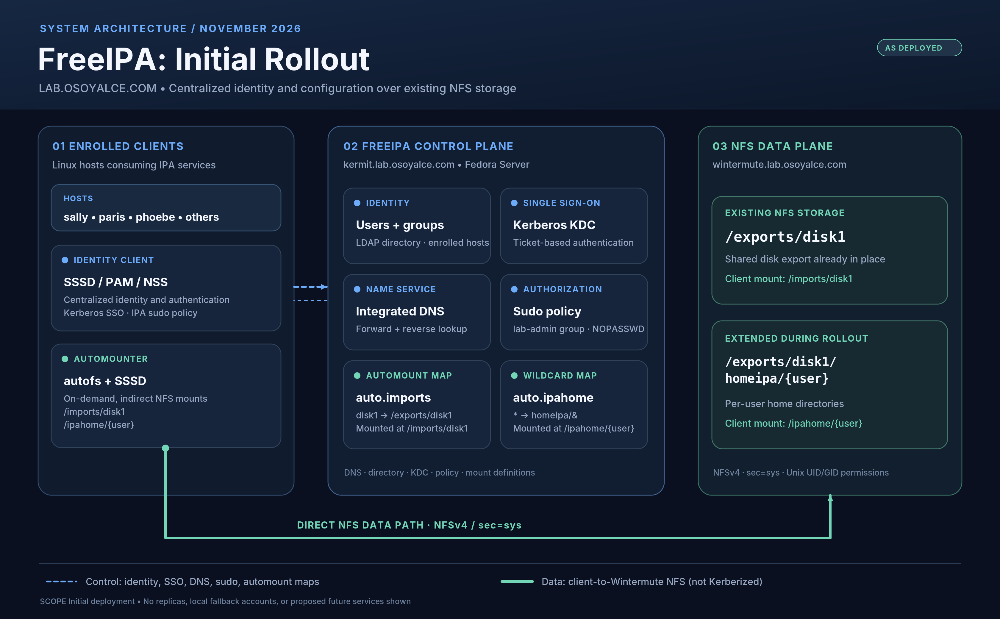
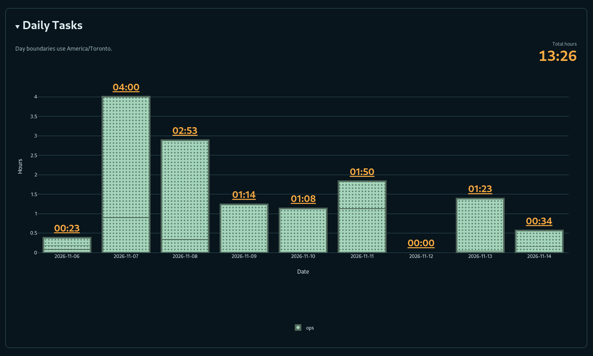
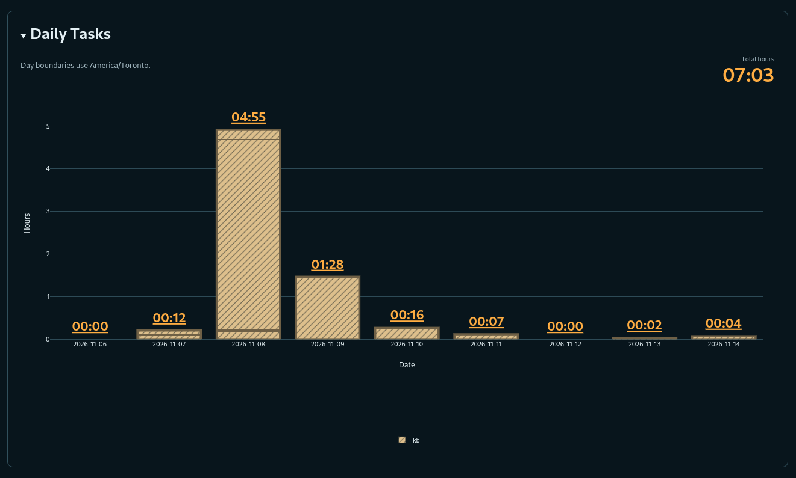
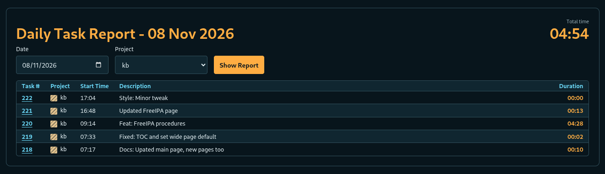

I'm building out my lab and as it grows, I've also needed to grow my compute infrastructure to keep up. What does that mean? It means, I don't want to spend an ever increasing amount of time dealing with individual machines and individual accounts. I want centralized DNS, certificate management, single sign on, centralized automounts. I found [FreeIPA](https://ipa.show/).

**FreeIPA** does everything I wanted and more and it did it at a professional level where I'd feel comfortable rolling it out for one of my financial clients. It's solid, it's secure, it rests on well understood, tried, tested, and true software like Kerberos and LDAP. Have a look at [here](https://ipa.show/reference/) if you'd like more info.



That was actually a bit of a problem. If you search for FreeIPA you get buried. There's too much information and most of it is tailored to a specific deployment. I ended up putting out another, similiar piece of content, when I documented my own [FreeIPA Setup](https://kb.osoyalce.com/pages/FreeIPA/).

But I did roll it out. It took a while. The [DevLog report](https://devlog.osoyalce.com) shows the *systems admin* type of work i.e. standing around, rebooting machines, reinstalling the OS and the software, messing it up, doing it again.



I tracked the R&D and the documentation work as well.



Here's some additional detail.



## Conclusion

FreeIPA is amazing and honestly, learning and doing an initial rollout in about 20 hours is good in my books. I **strongly** recommend it. In the meantime, I'm just geeking out! 🤓

```sh
dan@sally:~$ ssh nadim@neuromancer

nadim@neuromancer:~$ hostname | tee freeipa.txt
neuromancer.lab.osoyalce.com
nadim@neuromancer:~$ exit

dan@sally:~$ ssh nadim@paris
nadim@paris:~$ cat freeipa.txt 
neuromancer.lab.osoyalce.com
nadim@paris:~$ hostname >> freeipa.txt 
nadim@paris:~$ df .
Filesystem                                                1K-blocks       Used  Available Use% Mounted on
wintermute.lab.osoyalce.com:/exports/disk1/homeipa/nadim 7751272448 5677623296 1682931712  78% /ipahome/nadim
nadim@paris:~$ exit

dan@sally:~$ ssh nadim@bingo
nadim@bingo:~$ cat freeipa.txt 
neuromancer.lab.osoyalce.com
paris.lab.osoyalce.com
nadim@bingo:~$ kinit
Password for nadim@LAB.OSOYALCE.COM: 
nadim@bingo:~$ klist
Ticket cache: KEYRING:persistent:1469600007:krb_ccache_M47oi5A
Default principal: nadim@LAB.OSOYALCE.COM

Valid starting       Expires              Service principal
2026-11-14 08:18:29  2026-11-15 07:41:55  krbtgt/LAB.OSOYALCE.COM@LAB.OSOYALCE.COM
nadim@bingo:~$ 
```


