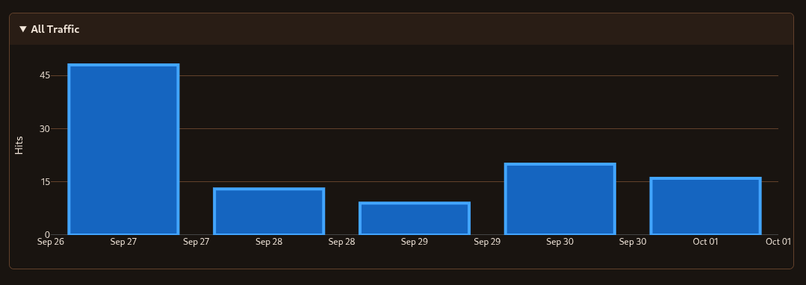
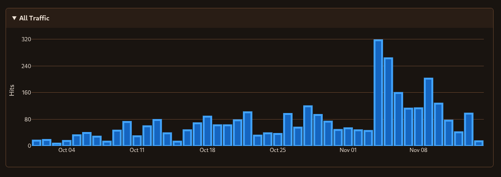
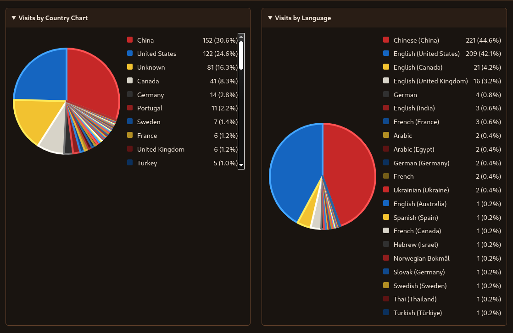
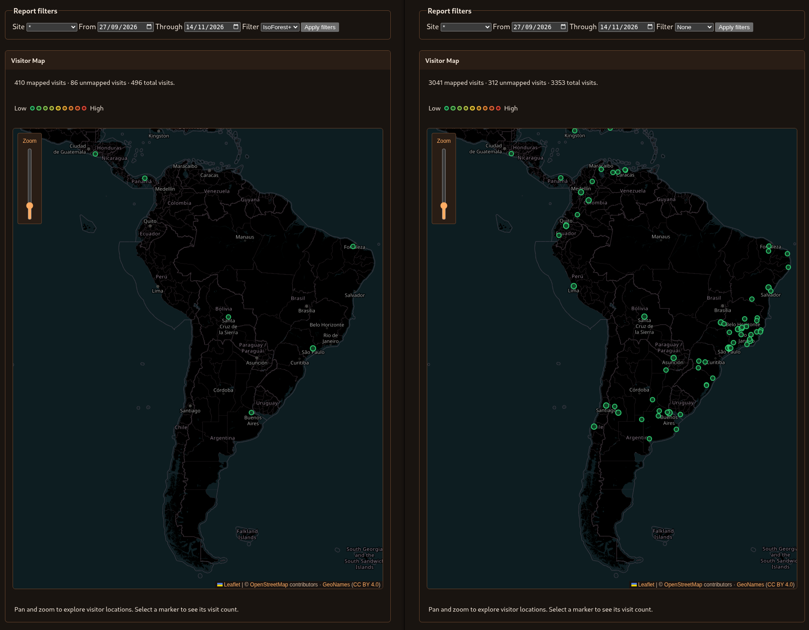
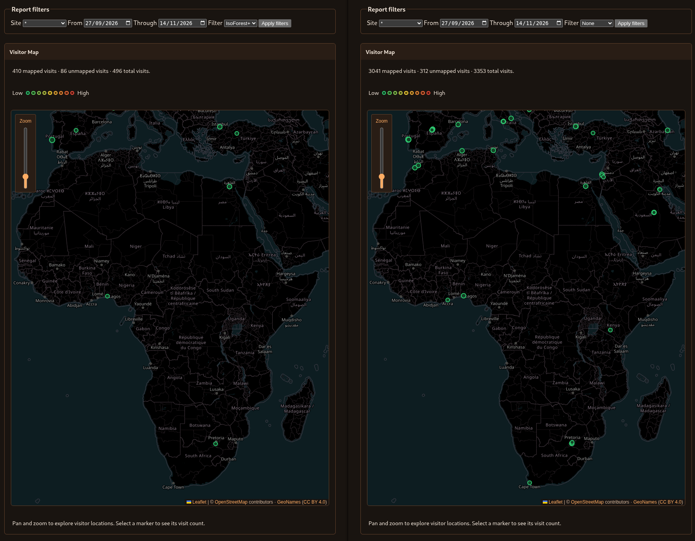
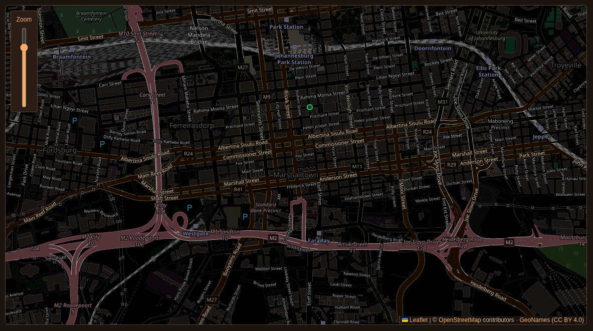

Almost 90% of my traffic is coming from bots or crawlers! I'm looking at (alleged) *visitors* to the websites under my [osoyalce.com](https://www.osoyalce.com) domain. Some of these visitors are clearly bots, they self identify, but most don't and some actively hide their identity.

When I created [MyCount](https://mycount.osoyalce.com), a website analytics platform, it came from a desire to see if people were looking at my open-source projects, and what kind of volume there was. I launched MyCount on September 27th, 2026, and have added additional `osoyaolce.com` sites since. Here's a snapshot going back to when data collection first started.

I initially ignored the odd data from the first day. When you first set things up, the pipeline can be a bit shakey, right? Or that's what I told myself. Everything looked pretty normal, until November:

That's actually not the whole story. Not even close. Right from the get go I rolled out some simple bot detection code. Then I tweaked it. Then I tweaked it again, and again, and again...

Version	| Date | Change
--- | --- | ---
0.5.0 | Sep 27 | Initial bot classification
0.7.3 | Sep 27 | Googlebot and GoogleOther detection
1.7.0 | Oct 9 | Added Bytespider
2.1.0 | Oct 17 | Added HeadlessChrome, WebDriver, and other automation signatures
2.7.0 | Oct 25 | Added renderer, viewport, and platform mismatch checks
2.9.1 | Oct 29 | Added coordinated crawler detection across rotating IPs and browser identities

I changed my backend database schema to make analysis easier.

I thought about integrating AI! I tried it with Qwen 3.5 4B running locally. It was a miserable failure. I'm not even sure that such a small model is capable of dealing with that volume of raw data.

I started researching and discovered that I wasn't alone. This was a widespread issue that's been [linked to ByteDance](https://mashable.com/article/tiktok-parent-company-bytedance-web-crawler-25-times-faster-than-openai). But the larger problem has been around forever, it's just getting worse. [CloudFlare](https://developers.cloudflare.com/bots/additional-configurations/block-ai-bots/) even has a section in their docs about it! 

In the end, I realized that my initial expectations were misplaced. There's simply no reliable way to tell if there's a human being on the other end or not. When you drill into the logs, you do see clear patterns of crawlers and bots. But now they seem to be trying to hide??!?

- The source IPs change
- The reported physical locations are spoofed
- Referrer sites are also spoofed

I did discover SciKit Learn's [IsoForest](https://scikit-learn.org/stable/modules/generated/sklearn.ensemble.IsolationForest.html), which is a data structure that can be used to find anomalies in your data. This turned out to be the most useful.

Version	| Date | Change
--- | --- | ---
3.5.0 | Nov 12 | Initial IsoForest implementation, using network-block analysis and Isolation Forest.
3.5.1 | Nov 13 | Made IsoForest+ the default traffic filter.
3.5.2 | Nov 13 | Removed the run notice and schedule link from the report interface.
3.5.3 | Nov 13 | Expanded detection with timezone discrepancies, browser-template reuse, viewport variations, platform consistency, and referral features.

It's not perfect or maybe it is! No, it's not. Some of the numbers are odd: Check out the locations and language settings. I seem to be popular in China!

When you start analyzing data, sometimes surprising patterns emerge. Check out the IsoForest filtered traffic from South and Central America. Historically, there has been a significant amount of DDos attacks by bot farms in South America. I'm not being attacked, but you can see there's a lot of activity coming my way.

Africa does not show the same pattern at all.

What does that mean? It's hard to say, I suspect that Africa is lagging with respect to technology and Internet access, but that's just a guess.

What I learned from all of this was that I can't really track human visitors and that almost 90% of the traffic my projects receive is from bots and crawlers. I still like it! I enjoy zooming into locations to see the maps. Look, this one is from South Africa!!

