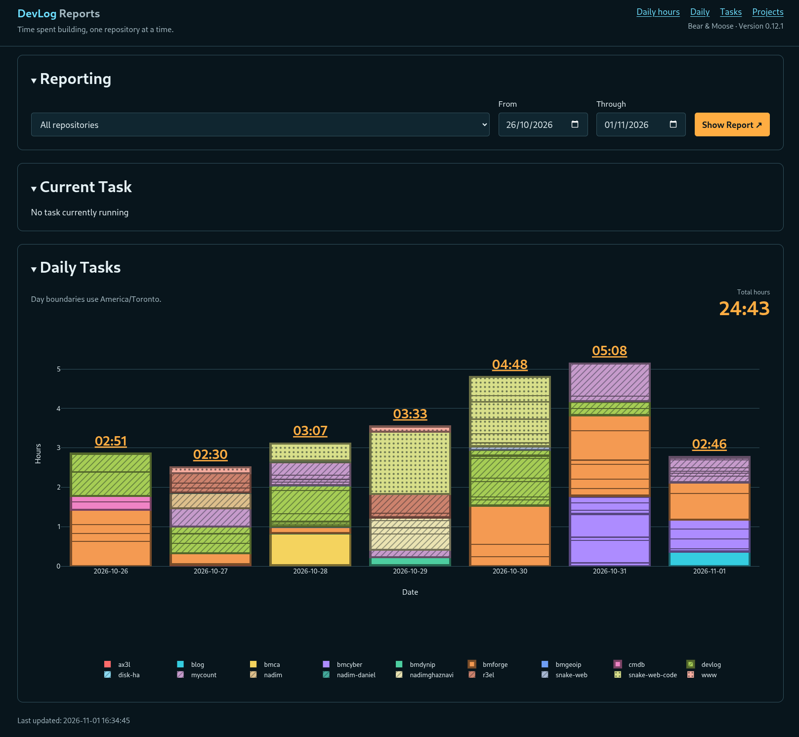
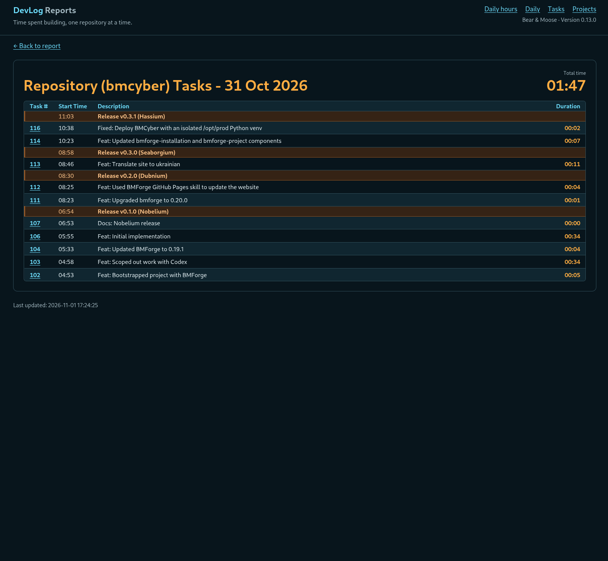
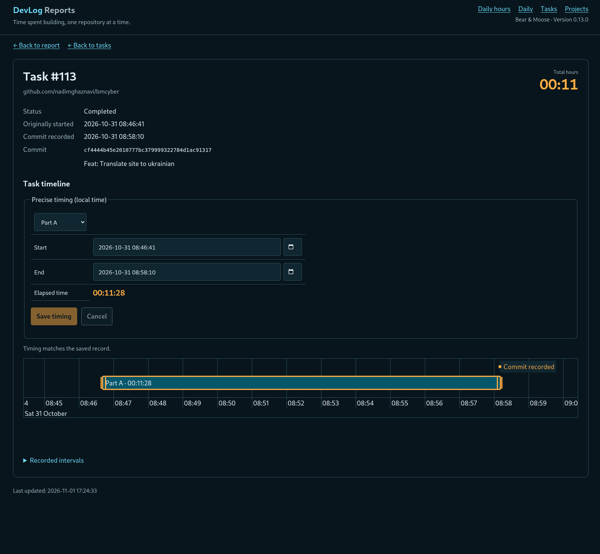

Ich habe [DevLog](https://devlog.osoyalce.com) entwickelt, um zu verfolgen, wie viel Zeit ich für meine Open-Source-Projekte aufwende. Ich wollte keine Unmenge ausgefallener Funktionen, sondern nur das Nötigste. Das ist dabei herausgekommen.

DevLog ist eine Client-Server-Anwendung, die ZeroMQ für den Nachrichtenaustausch verwendet. Wenn ich in einem Git-Repository den Befehl `dl start` ausführe, wird eine Nachricht an den DevLog-Server gesendet. Sobald die Arbeit erledigt ist, führe ich `dl commit` mit meiner Git-Commit-Nachricht aus. Meine Änderungen werden in Git committet und eine weitere Nachricht wird an den DevLog-Server gesendet. Ich bin noch einen Schritt weitergegangen und habe `dl publish` hinzugefügt. Damit wird im Wesentlichen ein Git-Release erstellt, einschließlich Merges, Feature-Branches und so weiter.

Jeder nutzt Git etwas anders, deshalb ist die Anwendung auf meinen persönlichen Arbeitsablauf zugeschnitten. Der einzige wirklich neue Befehl ist `dl start`. Meine bisherige Kurzform `gitcommit` habe ich durch `dl commit` ersetzt. Mein altes Skript `new-release.sh` rufe ich jetzt über `dl publish` auf.

Die Anwendung lässt sich problemlos um weitere Berichte erweitern, aber im Moment macht sie genau das, was ich brauche. Hier ist ein Screenshot, der die Arbeit eines Tages zeigt.

Hier ist eine Ansicht, in der nur ein einzelnes Projekt angezeigt wird.

Ab und zu vergesse ich, `dl start` auszuführen, wodurch die Zeiterfassung nicht mehr stimmt. Manchmal vergesse ich auch, eine laufende Aufgabe zu beenden. Das geschieht automatisch, wenn ich eine Aufgabe in einem anderen Repository starte oder `dl pause` ausführe. Deshalb habe ich zusätzlich einen Aufgabeneditor entwickelt, mit dem ich die erfassten Zeiten korrigieren kann.

