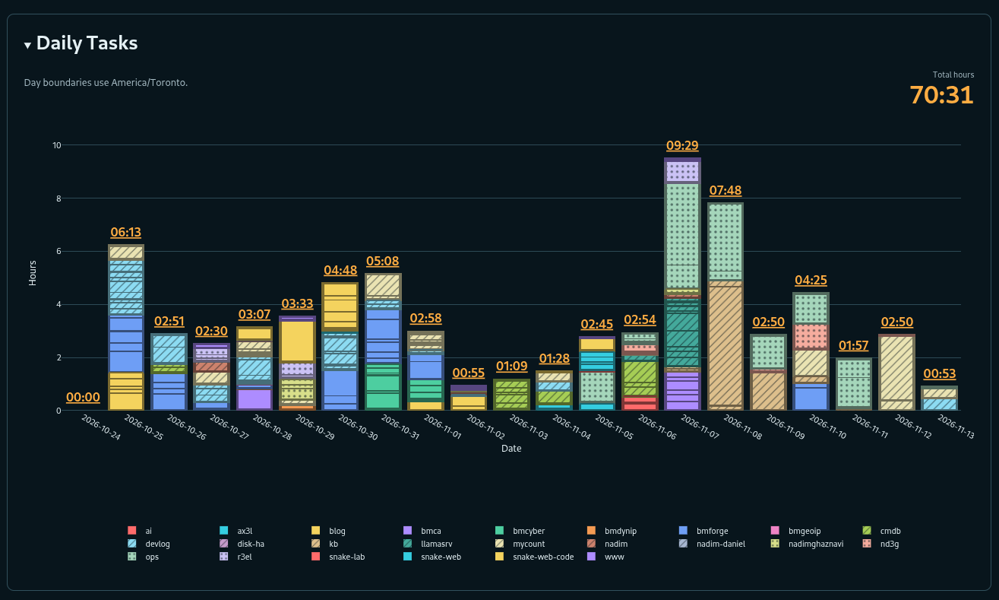

Ich dachte, es wäre an der Zeit, darüber zu berichten, wie sich mein Projekt [DevLog](https://devlog.osoyalce.com) in der Praxis bewährt. Vor fast drei Wochen habe ich es eingerichtet und angefangen, damit zu arbeiten. Und ich muss sagen: Ich bin wirklich begeistert!



DevLog zeigt mir nicht nur, wie viele Stunden ich in meine Open-Source-Projekte stecke. Es hilft mir außerdem dabei:

- Dort weiterzumachen, wo ich zuletzt aufgehört habe.
- Beruf, Privatleben und Projektarbeit besser in Einklang zu bringen.
- Zu erkennen, wofür meine Zeit draufgeht und was dabei, wenn überhaupt, herauskommt.

Eine Erkenntnis habe ich dabei gewonnen: Nicht jede Projektarbeit führt zu einem GitHub-Commit. Zum Beispiel:

- Beiträge für das Marketing
- Überprüfungen und Verifizierung
- Das Erstellen einer Spezifikation

Um auch solche Arbeiten zu erfassen, habe ich ein Repository namens **Ops** angelegt. Darin habe ich unter anderem die Einführung von [FreeIPA](https://kb.osoyalce.com/pages/FreeIPA/#add-a-fedora-machine-to-the-freeipa-domain) in meiner Laborumgebung dokumentiert. Das war ein ordentliches Stück Arbeit, und ich wollte die dafür aufgewendete Zeit in DevLog wiederfinden.

Außerdem habe ich die Ausgabe von `dl status` ein wenig angepasst, sodass jetzt auch pausierte Aufgaben angezeigt werden:

```
$ dl status
Repository (blog): Task #236 running for 00:17 (HH:MM)
Paused tasks:
  Repository (bmforge): Task #227 paused
$ 
```

Alles in allem bin ich mit [DevLog](https://devlog.osoyalce.com/) sehr zufrieden. Wenn ihr eure Arbeitszeit für GitHub-Projekte und darüber hinaus erfassen möchtet, schaut es euch an! Und wenn es euch gefällt oder ihr es interessant findet, gebt dem [DevLog-Repository auf GitHub](https://github.com/NadimGhaznavi/devlog) gerne einen Stern.
