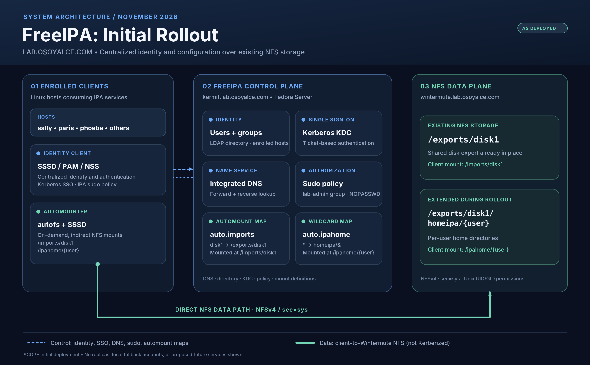
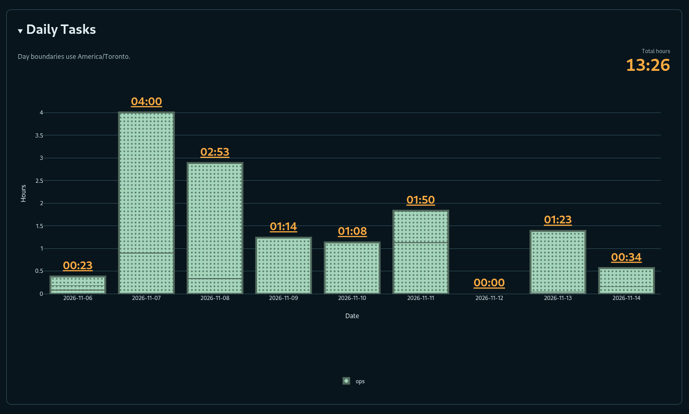
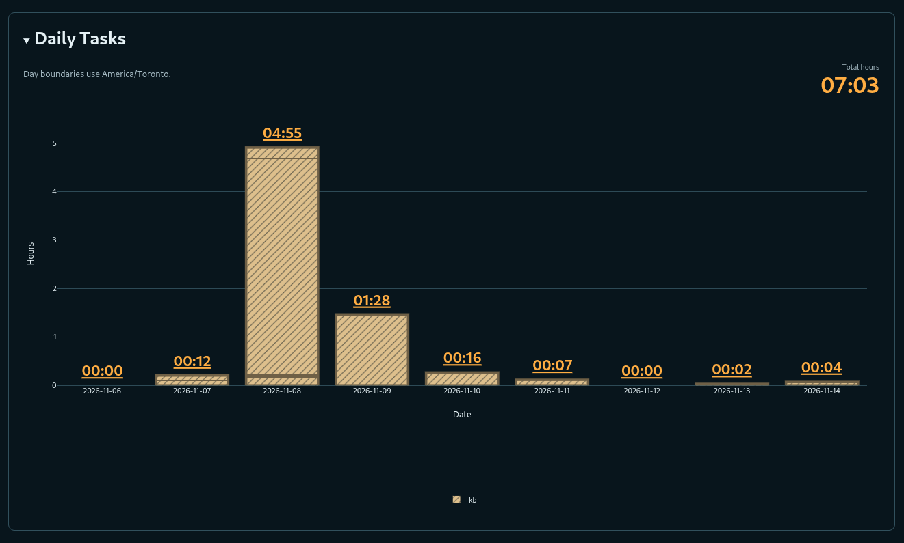
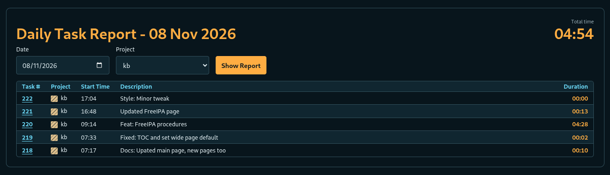

Ich baue mein Homelab nach und nach aus. Und je größer es wird, desto mehr muss auch meine Rechnerinfrastruktur mitwachsen. Was heißt das konkret? Ich möchte nicht immer mehr Zeit damit verbringen, einzelne Rechner und Benutzerkonten zu verwalten. Ich will zentrales DNS, Zertifikatsverwaltung, Single Sign-on und zentral verwaltete Automounts. So bin ich auf [FreeIPA](https://ipa.show/) gestoßen.

**FreeIPA** bietet alles, was ich wollte, und noch mehr. Und das auf einem professionellen Niveau, bei dem ich mich wohlfühlen würde, es auch bei einem meiner Kunden aus dem Finanzsektor einzuführen. Es ist solide und sicher und baut auf bewährten, gut verstandenen Technologien wie Kerberos und LDAP auf. Wer mehr erfahren möchte, kann sich [diese Referenz](https://ipa.show/reference/) ansehen.



Genau das war allerdings auch ein Problem. Wenn man nach FreeIPA sucht, wird man von Informationen geradezu erschlagen. Es gibt einfach zu viel davon, und das meiste ist auf eine bestimmte Einsatzumgebung zugeschnitten. Am Ende habe ich selbst noch eine ähnliche Anleitung veröffentlicht, als ich meine eigene [FreeIPA-Einrichtung](https://kb.osoyalce.com/pages/FreeIPA/) dokumentiert habe.

Aber ich habe FreeIPA tatsächlich eingeführt. Das hat eine Weile gedauert. Der [DevLog-Bericht](https://devlog.osoyalce.com) zeigt die Arbeit eines *Systemadministrators*: herumstehen und warten, Rechner neu starten, Betriebssystem und Software neu installieren, etwas vermasseln und noch einmal von vorne anfangen.



Auch die Zeit für Forschung und Entwicklung sowie für die Dokumentation habe ich erfasst.



Hier sind noch ein paar Details dazu.



## Fazit

FreeIPA ist großartig. Und rund 20 Stunden, um es kennenzulernen und erstmals einzuführen, sind für mich ein sehr gutes Ergebnis. Ich kann es **ausdrücklich** empfehlen. Und bis dahin habe ich einfach Spaß daran, mich in die Technik zu vertiefen! 🤓

```sh
dan@sally:~$ ssh nadim@neuromancer

nadim@neuromancer:~$ hostname | tee freeipa.txt
neuromancer.lab.osoyalce.com
nadim@neuromancer:~$ exit

dan@sally:~$ ssh nadim@paris
nadim@paris:~$ cat freeipa.txt 
neuromancer.lab.osoyalce.com
nadim@paris:~$ hostname >> freeipa.txt 
nadim@paris:~$ df .
Filesystem                                                1K-blocks       Used  Available Use% Mounted on
wintermute.lab.osoyalce.com:/exports/disk1/homeipa/nadim 7751272448 5677623296 1682931712  78% /ipahome/nadim
nadim@paris:~$ exit

dan@sally:~$ ssh nadim@bingo
nadim@bingo:~$ cat freeipa.txt 
neuromancer.lab.osoyalce.com
paris.lab.osoyalce.com
nadim@bingo:~$ kinit
Password for nadim@LAB.OSOYALCE.COM: 
nadim@bingo:~$ klist
Ticket cache: KEYRING:persistent:1469600007:krb_ccache_M47oi5A
Default principal: nadim@LAB.OSOYALCE.COM

Valid starting       Expires              Service principal
2026-11-14 08:18:29  2026-11-15 07:41:55  krbtgt/LAB.OSOYALCE.COM@LAB.OSOYALCE.COM
nadim@bingo:~$ 
```
