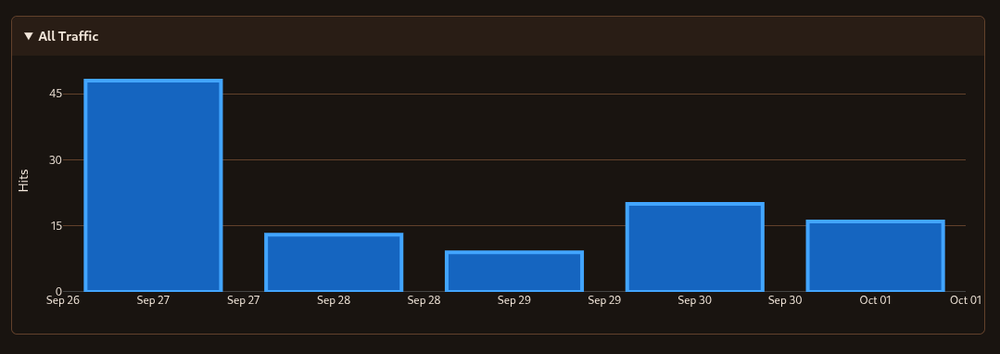
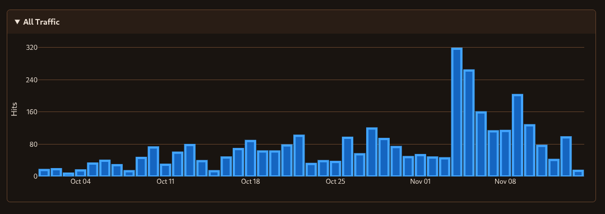
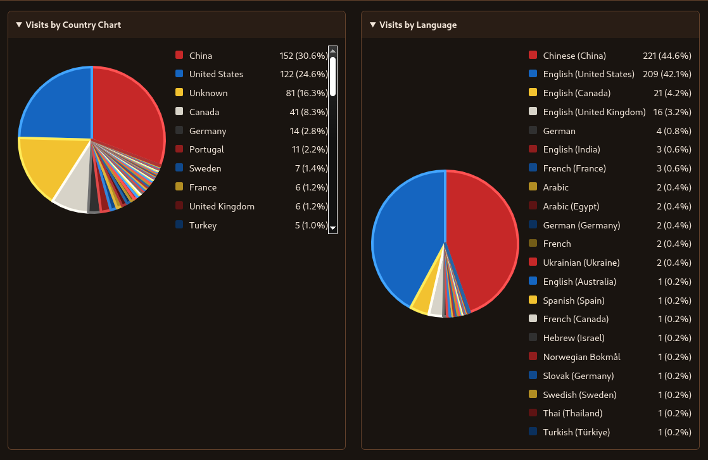
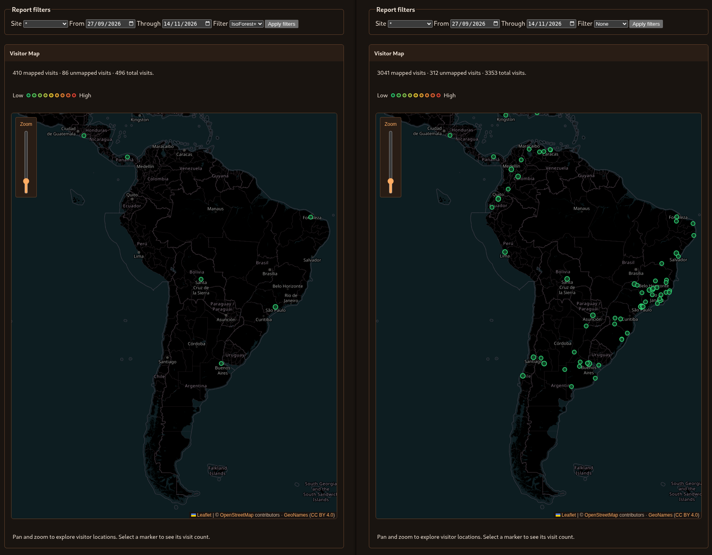
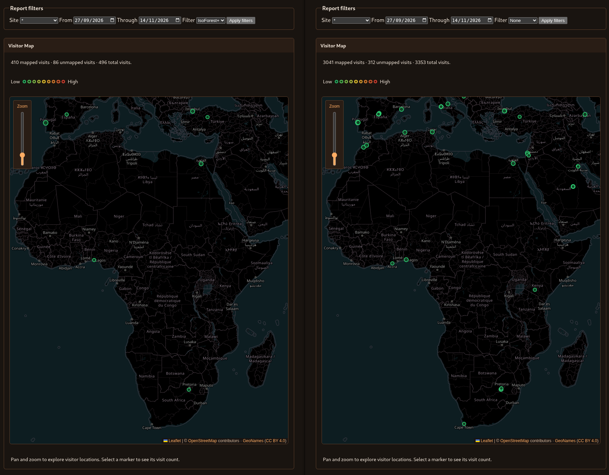
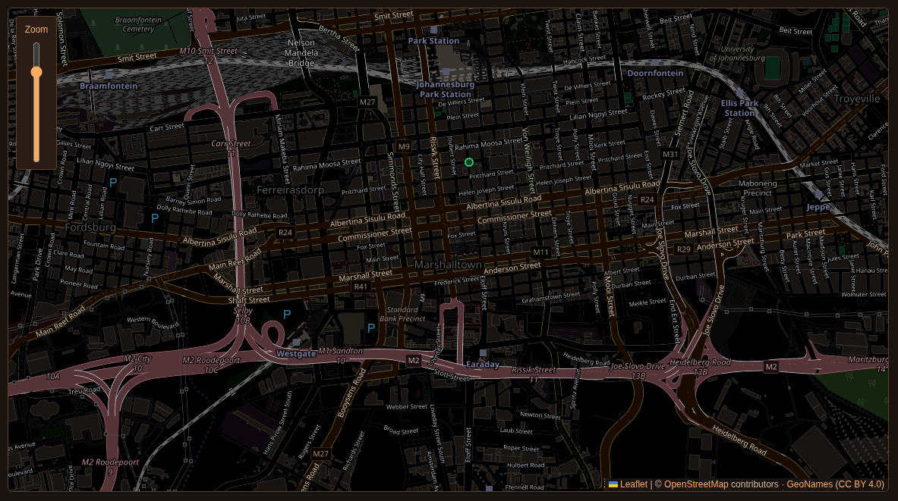

Fast 90 % meines Traffics stammen von Bots oder Crawlern! Ich untersuche die vermeintlichen *Besucher* der Websites unter meiner Domain [osoyalce.com](https://www.osoyalce.com). Einige dieser Besucher sind ganz offensichtlich Bots und geben sich auch als solche zu erkennen. Die meisten tun das allerdings nicht, und manche verbergen ihre Identität sogar aktiv.

Als ich [MyCount](https://mycount.osoyalce.com), meine Plattform zur Website-Analyse, entwickelte, wollte ich herausfinden, ob sich Menschen meine Open-Source-Projekte ansehen und wie viel Traffic dabei zusammenkommt. Ich habe MyCount am 27. September 2026 gestartet und seitdem weitere Websites unter `osoyalce.com` hinzugefügt. Hier ist eine Übersicht, die bis zum Beginn der Datenerfassung zurückreicht.

Die auffälligen Daten vom ersten Tag habe ich zunächst ignoriert. Wenn man so etwas gerade erst einrichtet, kann die Datenpipeline doch etwas wackelig sein, oder? Zumindest habe ich mir das eingeredet. Bis zum November sah alles ziemlich normal aus:

Aber das ist noch längst nicht die ganze Geschichte. Von Anfang an hatte ich eine einfache Bot-Erkennung eingebaut. Dann habe ich sie angepasst. Und noch einmal. Und wieder und wieder ...

Version | Datum | Änderung
--- | --- | ---
0.5.0 | 27. Sep. | Erste Klassifizierung von Bots
0.7.3 | 27. Sep. | Erkennung von Googlebot und GoogleOther
1.7.0 | 9. Okt. | Bytespider hinzugefügt
2.1.0 | 17. Okt. | Signaturen für HeadlessChrome, WebDriver und weitere Automatisierungswerkzeuge hinzugefügt
2.7.0 | 25. Okt. | Prüfungen auf Unstimmigkeiten bei Renderer, Viewport und Plattform hinzugefügt
2.9.1 | 29. Okt. | Erkennung koordinierter Crawler mit wechselnden IP-Adressen und Browser-Identitäten hinzugefügt

Außerdem habe ich das Schema meiner Backend-Datenbank geändert, um die Analyse zu erleichtern.

Ich habe sogar überlegt, KI einzubinden! Ich habe es mit einem lokal laufenden Qwen 3.5 4B versucht. Das war ein völliger Fehlschlag. Ich bin mir nicht einmal sicher, ob ein so kleines Modell diese Menge an Rohdaten bewältigen kann.

Also begann ich zu recherchieren und stellte fest, dass ich damit nicht allein bin. Das Phänomen war weit verbreitet und wurde [mit ByteDance in Verbindung gebracht](https://mashable.com/article/tiktok-parent-company-bytedance-web-crawler-25-times-faster-than-openai). Das grundlegende Problem gibt es aber schon seit Ewigkeiten, und es wird immer schlimmer. Selbst [Cloudflare](https://developers.cloudflare.com/bots/additional-configurations/block-ai-bots/) hat einen eigenen Abschnitt dazu in seiner Dokumentation!

Schließlich wurde mir klar, dass meine ursprünglichen Erwartungen fehlgeleitet waren. Es gibt schlicht keine zuverlässige Methode, um festzustellen, ob am anderen Ende tatsächlich ein Mensch sitzt. Wenn man die Protokolle genauer untersucht, erkennt man deutliche Muster von Bots und Crawlern. Aber inzwischen scheinen sie zu versuchen, sich zu verstecken?!?

- Die Quell-IP-Adressen wechseln.
- Die gemeldeten geografischen Standorte werden gefälscht.
- Auch die Referrer-Websites werden vorgetäuscht.

Dabei entdeckte ich [IsoForest](https://scikit-learn.org/stable/modules/generated/sklearn.ensemble.IsolationForest.html) aus Scikit-learn, ein Verfahren zum Erkennen von Anomalien in Daten. Das erwies sich als der nützlichste Ansatz.

Version | Datum | Änderung
--- | --- | ---
3.5.0 | 12. Nov. | Erste IsoForest-Implementierung mit Analyse von Netzwerkblöcken und Isolation Forest
3.5.1 | 13. Nov. | IsoForest+ als Standardfilter für den Traffic festgelegt
3.5.2 | 13. Nov. | Ausführungshinweis und Zeitplan-Link aus der Berichtsoberfläche entfernt
3.5.3 | 13. Nov. | Erkennung um Zeitzonenabweichungen, wiederverwendete Browser-Vorlagen, Viewport-Variationen, Plattformkonsistenz und Referrer-Merkmale erweitert

Perfekt ist das nicht. Oder vielleicht doch? Nein, ist es nicht. Einige Zahlen sind merkwürdig. Schaut euch die Standorte und Spracheinstellungen an. Offenbar bin ich in China ziemlich beliebt!

Wenn man anfängt, Daten zu analysieren, tauchen manchmal überraschende Muster auf. Seht euch den von IsoForest gefilterten Traffic aus Süd- und Mittelamerika an. Historisch gab es dort erhebliche DDoS-Angriffe durch Bot-Farmen. Ich werde nicht angegriffen, aber es ist deutlich zu sehen, wie viel Aktivität mich erreicht.

In Afrika zeigt sich dieses Muster überhaupt nicht.

Was bedeutet das? Schwer zu sagen. Ich vermute, dass Afrika hinsichtlich Technologie und Internetzugang zurückliegt. Aber das ist nur eine Vermutung.

Ich habe aus all dem gelernt, dass ich menschliche Besucher nicht wirklich zuverlässig erfassen kann und dass fast 90 % des Traffics meiner Projekte von Bots und Crawlern stammen. Trotzdem gefällt mir das Ganze noch immer! Ich zoome gerne in die Standorte hinein und schaue mir die Karten an. Seht mal, dieser Zugriff kam aus Südafrika!

