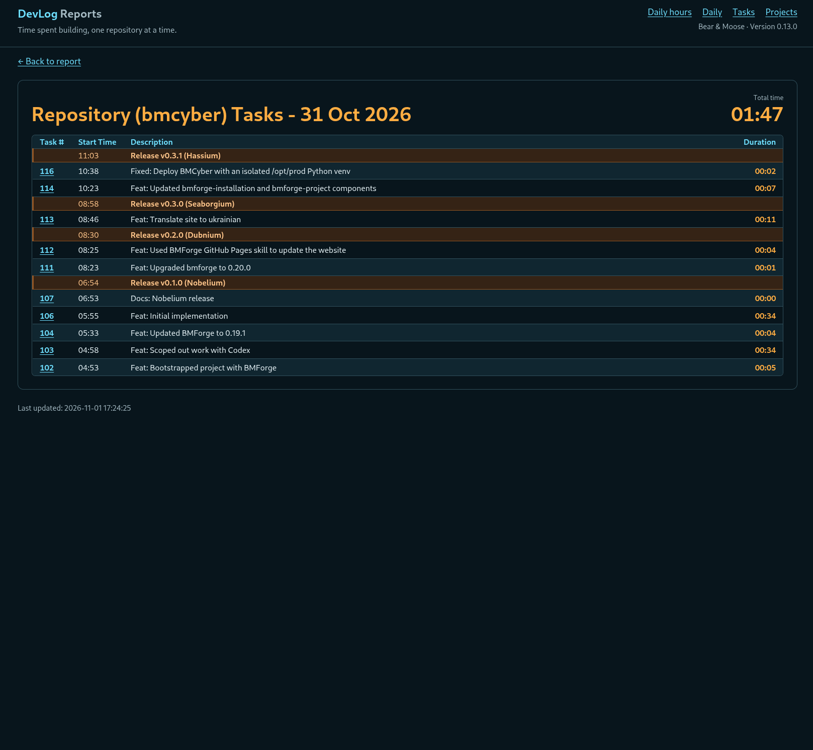

Creé [DevLog](https://devlog.osoyalce.com) para llevar un registro del tiempo que dedicaba a mis proyectos de código abierto. No quería un montón de funciones sofisticadas, solo lo básico. Este es el resultado.

Es una aplicación cliente-servidor que utiliza ZeroMQ para intercambiar mensajes. Cuando ejecuto `dl start` dentro de un repositorio Git, se envía un mensaje al servidor de DevLog. Al terminar el trabajo, ejecuto `dl commit` junto con mi mensaje de commit de Git. Los cambios quedan registrados en Git y se envía otro mensaje al servidor de DevLog. Fui un paso más allá y añadí `dl publish`, que básicamente prepara una nueva versión del proyecto mediante Git (fusiones de ramas, ramas de funcionalidades, etc.).

Cada persona utiliza Git de manera diferente, así que esta aplicación está adaptada a mi propio flujo de trabajo. El único comando realmente nuevo es `dl start`. Reemplacé mi antiguo atajo `gitcommit` por `dl commit`. Ahora ejecuto mi viejo script `new-release.sh` a través de `dl publish`.

La aplicación se puede ampliar fácilmente para añadir más informes, pero por ahora hace todo lo que necesito. Aquí tienen una captura de pantalla que muestra el trabajo de un día.

Aquí hay una vista que muestra un solo proyecto.

De vez en cuando se me olvida ejecutar `dl start`, por lo que el registro de tiempo queda desajustado. También he olvidado detener una tarea en curso. Eso ocurre automáticamente cuando inicio una tarea en otro repositorio o ejecuto `dl pause`. Por eso también creé un editor de tareas que me permite corregir los tiempos registrados.

