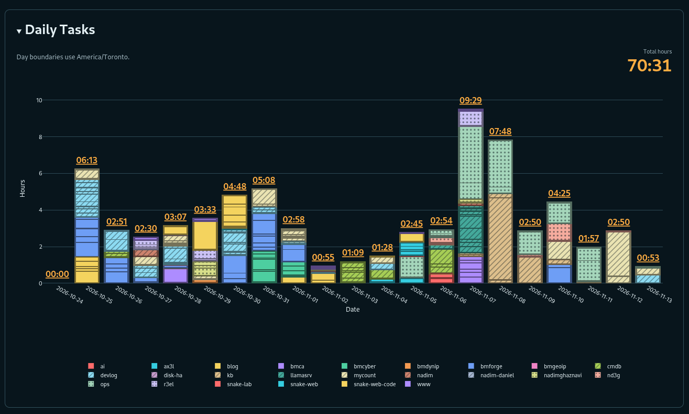

Quería escribir una continuación para contar cómo me está yendo con [DevLog](https://devlog.osoyalce.com). Lo instalé y empecé a utilizarlo hace casi tres semanas. ¡Y tengo que decir que me encanta!



No solo me ofrece una visión general de las horas que dedico a mis proyectos de código abierto. También me ayuda a:

- Retomar el trabajo donde lo dejé.
- Mantener un mejor equilibrio entre la vida personal y el trabajo.
- Ver en qué invierto mi tiempo y qué resultados, si los hay, estoy produciendo.

He aprendido algo importante: no todo el trabajo de un proyecto termina en un commit de GitHub. Por ejemplo:

- Publicaciones de marketing
- Verificación
- Elaboración de especificaciones

Para registrar esas actividades, creé un repositorio llamado **Ops**. Lo utilicé para contabilizar el despliegue de [FreeIPA](https://kb.osoyalce.com/pages/FreeIPA/#add-a-fedora-machine-to-the-freeipa-domain) en mi laboratorio. Fue bastante trabajo y quería que esas horas aparecieran en DevLog.

También hice un pequeño ajuste a la salida de `dl status` para que muestre las tareas pausadas:

```
$ dl status
Repository (blog): Task #236 running for 00:17 (HH:MM)
Paused tasks:
  Repository (bmforge): Task #227 paused
$ 
```

En definitiva, estoy muy contento con [DevLog](https://devlog.osoyalce.com/). Si les interesa registrar el tiempo que dedican a sus proyectos de GitHub, y a otras actividades, ¡échenle un vistazo! Y si les gusta o les parece interesante, les agradecería que le dieran una estrella al [repositorio de DevLog en GitHub](https://github.com/NadimGhaznavi/devlog).
