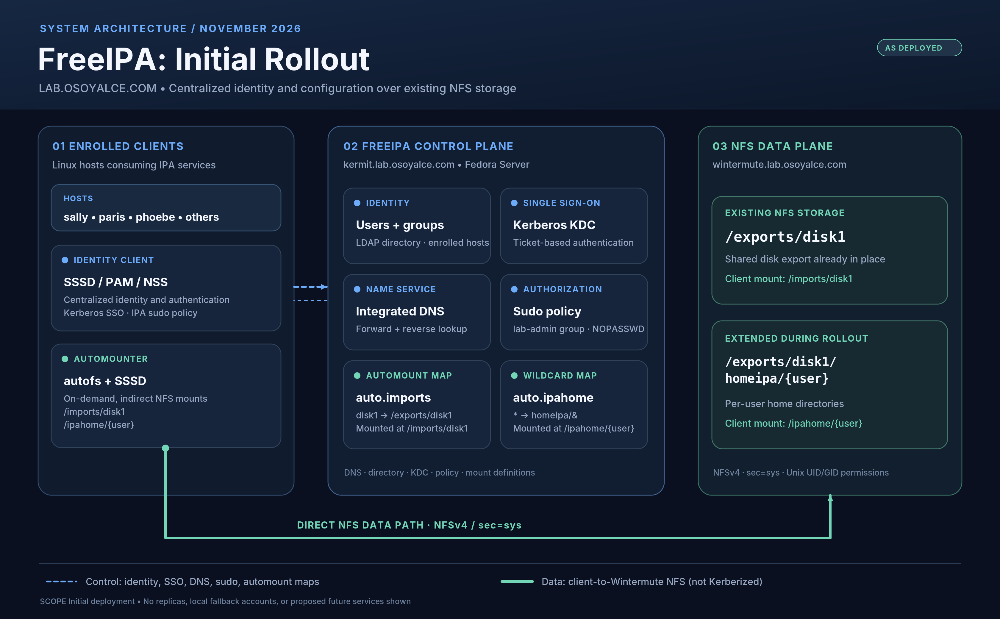
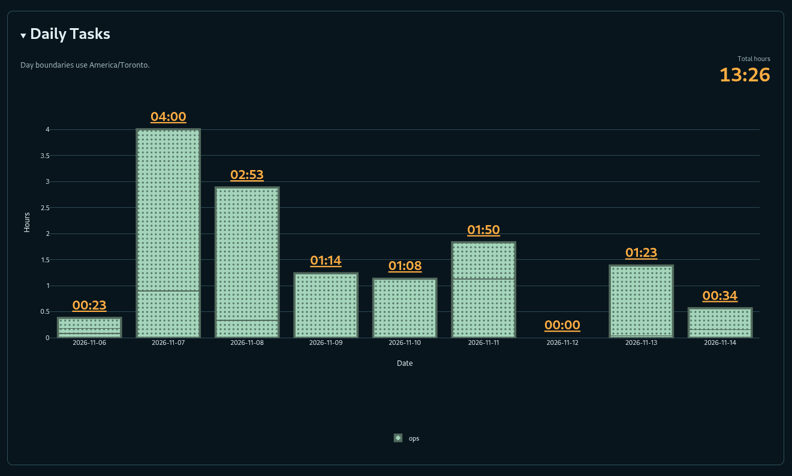
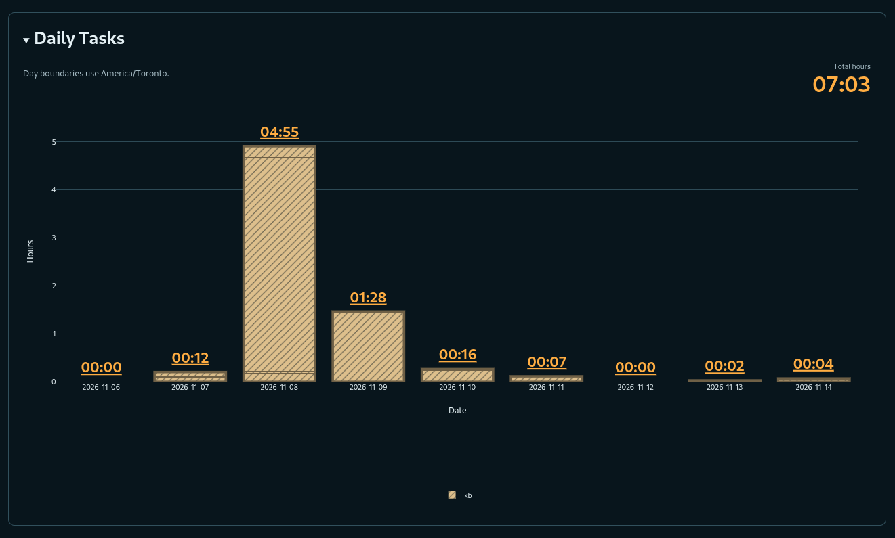
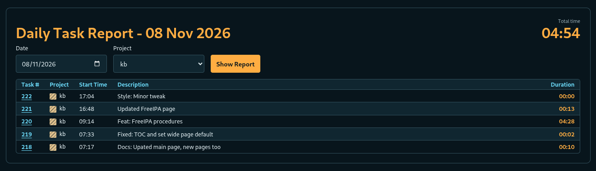

Estoy ampliando mi laboratorio poco a poco y, a medida que crece, también necesito ampliar la infraestructura informática para seguirle el ritmo. ¿Qué significa eso? Que no quiero dedicar cada vez más tiempo a gestionar máquinas y cuentas individuales. Quiero DNS centralizado, gestión de certificados, inicio de sesión único y montajes automáticos administrados de forma centralizada. Así fue como encontré [FreeIPA](https://ipa.show/).

**FreeIPA** hace todo lo que quería y más, con un nivel profesional que me daría confianza para desplegarlo incluso para uno de mis clientes del sector financiero. Es sólido y seguro, y se basa en tecnologías bien conocidas, probadas y contrastadas como Kerberos y LDAP. Si quieres saber más, echa un vistazo a [esta referencia](https://ipa.show/reference/).



En realidad, eso también fue parte del problema. Si buscas FreeIPA, te sepulta una avalancha de información. Hay demasiada, y la mayoría está adaptada a un despliegue concreto. Al final terminé publicando otro material parecido cuando documenté mi propia [configuración de FreeIPA](https://kb.osoyalce.com/pages/FreeIPA/).

Pero conseguí desplegarlo. Me llevó un tiempo. El [informe de DevLog](https://devlog.osoyalce.com) muestra el trabajo de *administración de sistemas*: estar esperando, reiniciar máquinas, reinstalar el sistema operativo y el software, meter la pata y volver a empezar.



También registré el tiempo dedicado a investigación, desarrollo y documentación.



Aquí van algunos detalles adicionales.



## Conclusión

FreeIPA es fantástico y, para mí, aprender a utilizarlo y completar un primer despliegue en unas 20 horas es un buen resultado. Lo recomiendo **encarecidamente**. Mientras tanto, ¡yo sigo disfrutando como un auténtico friki de la tecnología! 🤓

```sh
dan@sally:~$ ssh nadim@neuromancer

nadim@neuromancer:~$ hostname | tee freeipa.txt
neuromancer.lab.osoyalce.com
nadim@neuromancer:~$ exit

dan@sally:~$ ssh nadim@paris
nadim@paris:~$ cat freeipa.txt 
neuromancer.lab.osoyalce.com
nadim@paris:~$ hostname >> freeipa.txt 
nadim@paris:~$ df .
Filesystem                                                1K-blocks       Used  Available Use% Mounted on
wintermute.lab.osoyalce.com:/exports/disk1/homeipa/nadim 7751272448 5677623296 1682931712  78% /ipahome/nadim
nadim@paris:~$ exit

dan@sally:~$ ssh nadim@bingo
nadim@bingo:~$ cat freeipa.txt 
neuromancer.lab.osoyalce.com
paris.lab.osoyalce.com
nadim@bingo:~$ kinit
Password for nadim@LAB.OSOYALCE.COM: 
nadim@bingo:~$ klist
Ticket cache: KEYRING:persistent:1469600007:krb_ccache_M47oi5A
Default principal: nadim@LAB.OSOYALCE.COM

Valid starting       Expires              Service principal
2026-11-14 08:18:29  2026-11-15 07:41:55  krbtgt/LAB.OSOYALCE.COM@LAB.OSOYALCE.COM
nadim@bingo:~$ 
```
