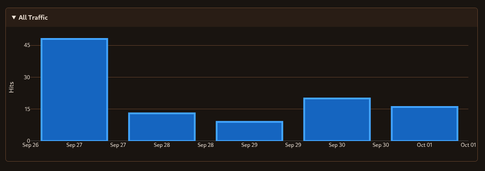
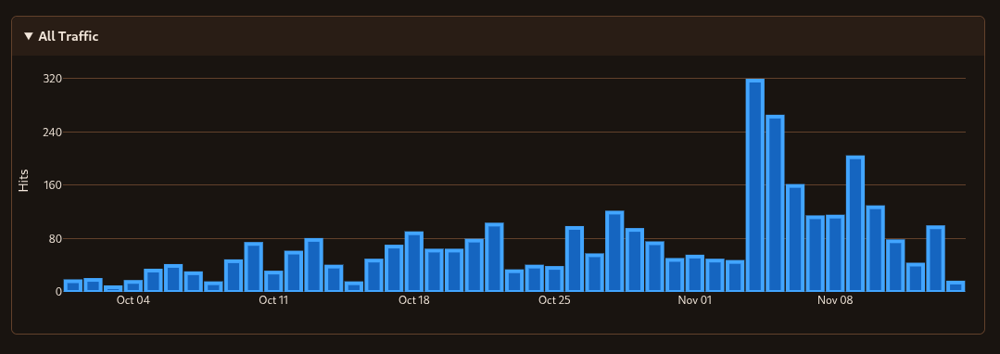
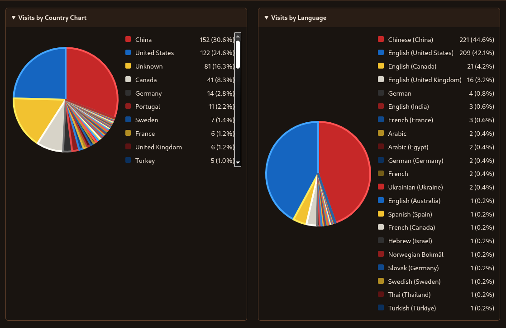
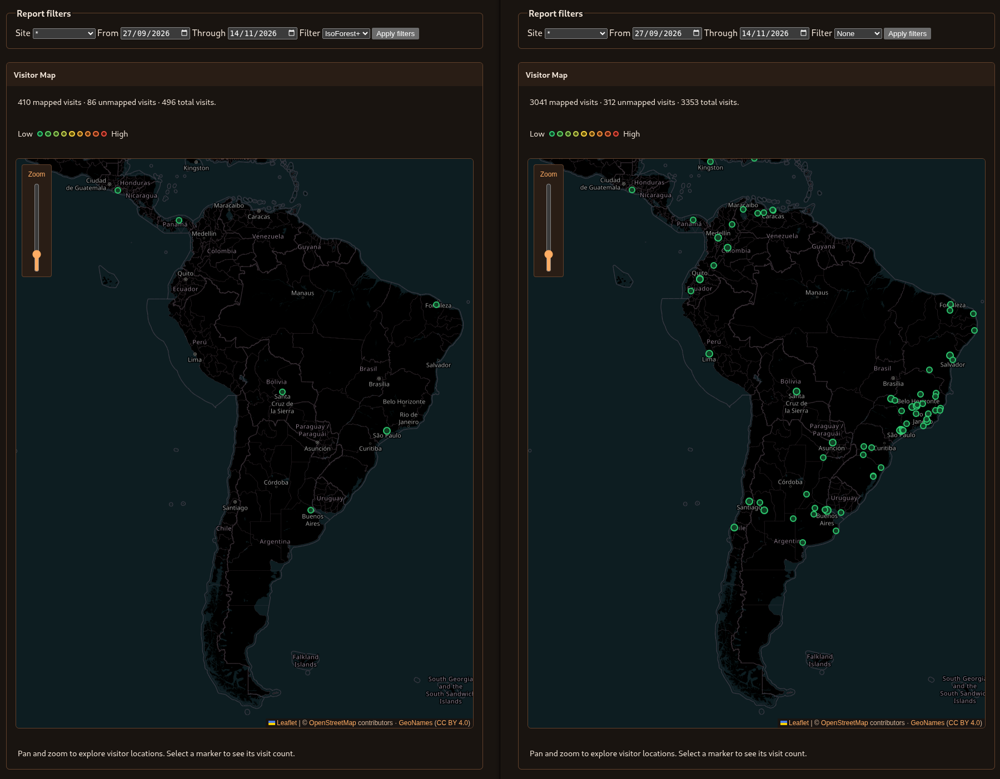
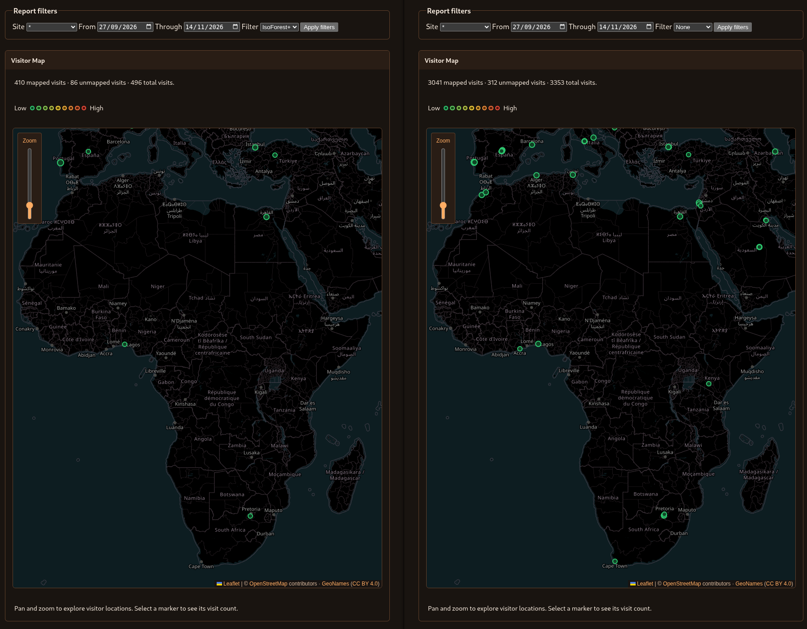
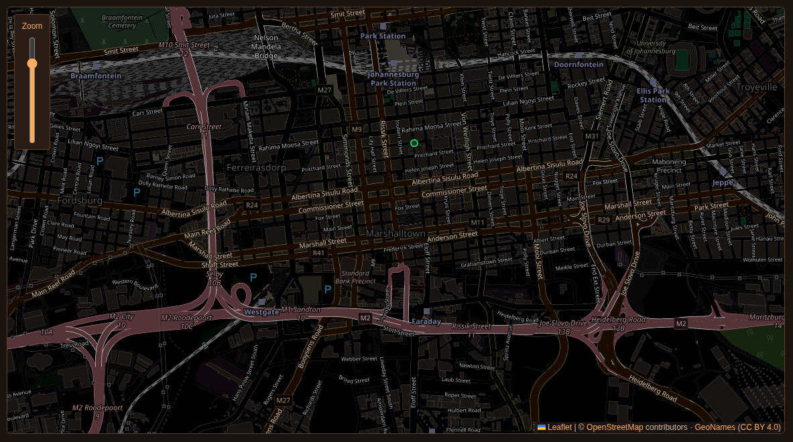

¡Casi el 90 % del tráfico que recibo proviene de bots o rastreadores! Estoy analizando a los supuestos *visitantes* de los sitios web de mi dominio [osoyalce.com](https://www.osoyalce.com). Algunos son claramente bots y se identifican como tales, pero la mayoría no lo hace, e incluso hay quienes ocultan activamente su identidad.

Cuando creé [MyCount](https://mycount.osoyalce.com), una plataforma de análisis de sitios web, lo hice porque quería saber si la gente visitaba mis proyectos de código abierto y cuánto tráfico recibían. Puse MyCount en marcha el 27 de septiembre de 2026 y desde entonces he añadido otros sitios de `osoyalce.com`. Esta es una captura de cuando empezó la recopilación de datos.

Más o menos ignoré los datos del primer día. Cuando acabas de poner todo en funcionamiento, la cadena de procesamiento puede fallar un poco, ¿verdad? O al menos eso me decía. Todo parecía bastante normal hasta noviembre:

Pero esa no es toda la historia. Ni de lejos. Desde el principio implementé un sistema sencillo para detectar bots. Después lo ajusté. Y lo volví a ajustar. Y otra vez, y otra, y otra...

Versión | Fecha | Cambio
--- | --- | ---
0.5.0 | 27 sep. | Clasificación inicial de bots
0.7.3 | 27 sep. | Detección de Googlebot y GoogleOther
1.7.0 | 9 oct. | Se añadió Bytespider
2.1.0 | 17 oct. | Se añadieron firmas de HeadlessChrome, WebDriver y otras herramientas de automatización
2.7.0 | 25 oct. | Se añadieron comprobaciones de discrepancias entre motor de renderizado, área visible y plataforma
2.9.1 | 29 oct. | Se añadió la detección de rastreadores coordinados que alternan direcciones IP e identidades de navegador

También modifiqué el esquema de mi base de datos del servidor para facilitar el análisis.

¡Hasta pensé en integrar inteligencia artificial! Lo intenté con Qwen 3.5 4B ejecutándose localmente. Fue un fracaso rotundo. Ni siquiera estoy seguro de que un modelo tan pequeño pueda manejar semejante volumen de datos sin procesar.

Empecé a investigar y descubrí que no era el único con este problema. Es algo muy extendido, que existe desde hace mucho tiempo y que está empeorando. ¡Incluso [Cloudflare](https://developers.cloudflare.com/bots/additional-configurations/block-ai-bots/) le dedica una sección de su documentación!

Al final comprendí que mis expectativas iniciales no eran realistas. Simplemente no existe una forma fiable de saber si hay una persona al otro lado. Al examinar los registros con detenimiento, sí se observan patrones claros de bots y rastreadores. Pero ¿ahora parece que intentan ocultarse?!?

- Cambian las direcciones IP de origen.
- Se falsifican las ubicaciones geográficas declaradas.
- También se falsifican los sitios de referencia.

Descubrí [IsoForest](https://scikit-learn.org/stable/modules/generated/sklearn.ensemble.IsolationForest.html), de Scikit-learn, una técnica para encontrar anomalías en los datos. Resultó ser lo más útil de todo.

Versión | Fecha | Cambio
--- | --- | ---
3.5.0 | 12 nov. | Primera implementación de IsoForest, con análisis por bloques de red y Isolation Forest
3.5.1 | 13 nov. | IsoForest+ se convirtió en el filtro de tráfico predeterminado
3.5.2 | 13 nov. | Se eliminaron el aviso de ejecución y el enlace de programación de la interfaz de informes
3.5.3 | 13 nov. | Se amplió la detección con discrepancias de zona horaria, reutilización de plantillas de navegador, variaciones del área visible, coherencia de plataforma y características de las referencias

No es perfecto. ¿O quizá sí? No, no lo es. Algunas cifras son extrañas. Fíjense en las ubicaciones y en la configuración de idiomas. ¡Parece que tengo mucha popularidad en China!

Cuando empiezas a analizar datos, a veces aparecen patrones sorprendentes. Miren el tráfico de Sudamérica y Centroamérica después de aplicar el filtro de IsoForest. Históricamente, ha habido una cantidad considerable de ataques DDoS realizados por granjas de bots en Sudamérica. No estoy sufriendo un ataque, pero se ve que hay mucha actividad dirigida hacia mis sitios.

En África no aparece ese mismo patrón en absoluto.

¿Qué significa eso? Es difícil saberlo. Sospecho que África lleva cierto retraso en tecnología y acceso a Internet, pero no es más que una suposición.

La lección que me llevo de todo esto es que realmente no puedo hacer un seguimiento fiable de los visitantes humanos y que casi el 90 % del tráfico que reciben mis proyectos procede de bots y rastreadores. ¡Y aun así me gusta! Disfruto acercándome a los lugares para explorar los mapas. ¡Miren, esta visita vino de Sudáfrica!

