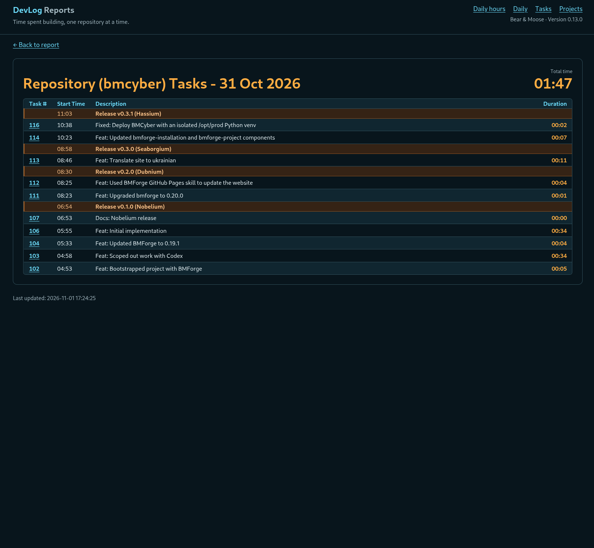

Я створив [DevLog](https://devlog.osoyalce.com), щоб відстежувати, скільки часу витрачаю на свої проєкти з відкритим кодом. Мені не потрібна була купа складних функцій, лише найнеобхідніше. Ось що вийшло.

Це клієнт-серверний застосунок, який використовує ZeroMQ для обміну повідомленнями. Коли я виконую команду `dl start` у репозиторії Git, на сервер DevLog надсилається повідомлення. Закінчивши роботу, я виконую `dl commit` разом із повідомленням коміту Git. Мої зміни фіксуються в Git, а на сервер DevLog надходить ще одне повідомлення. Я пішов трохи далі й додав `dl publish`, який фактично створює реліз Git, включно зі злиттям гілок, роботою з функціональними гілками тощо.

Кожен працює з Git по-своєму, тому цей застосунок пристосований до мого особистого робочого процесу. Єдина справді нова команда тут — `dl start`. Свій старий ярлик `gitcommit` я замінив на `dl commit`. А свій попередній скрипт `new-release.sh` тепер запускаю через `dl publish`.

Застосунок легко розширити новими звітами, але наразі він робить усе, що мені потрібно. Ось знімок екрана з роботою за один день.

А ось вигляд, де показано лише один проєкт.

Час від часу я забуваю виконати `dl start`, і облік часу збивається. Іноді також забуваю зупинити поточне завдання. Це відбувається автоматично, коли я починаю завдання в іншому репозиторії або виконую `dl pause`. Тому я додав редактор завдань, щоб можна було виправляти записаний час.

