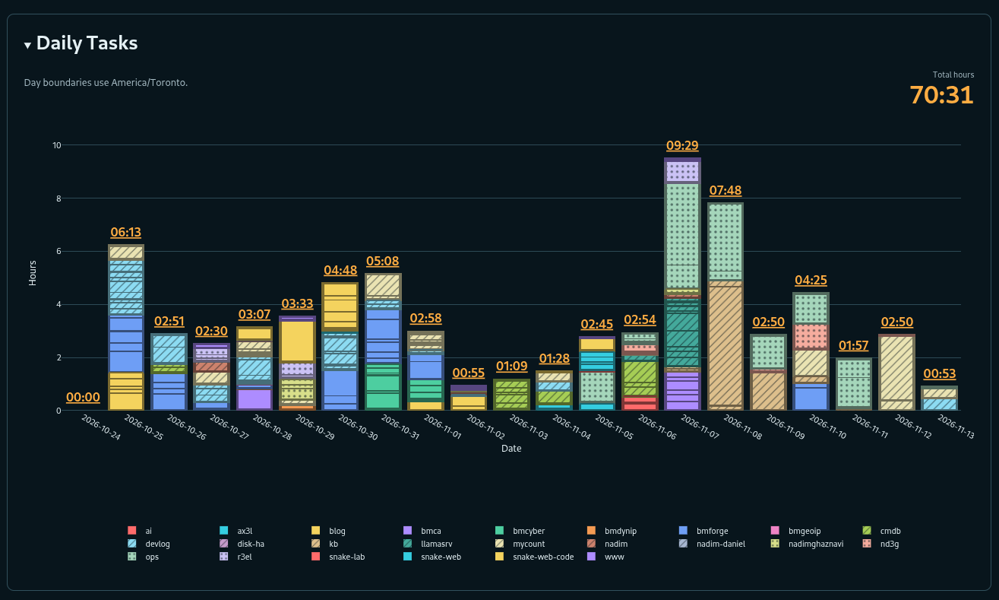

Вирішив написати продовження й розповісти, як показує себе мій проєкт [DevLog](https://devlog.osoyalce.com). Я розгорнув його й почав користуватися ним майже три тижні тому. І мушу сказати: мені він справді дуже подобається!



DevLog не лише дає мені загальне уявлення про те, скільки годин я витрачаю на свої проєкти з відкритим кодом. Він також допомагає:

- Продовжувати роботу з того місця, де я зупинився.
- Краще підтримувати баланс між роботою та особистим життям.
- Бачити, на що йде мій час і що, якщо взагалі щось, вдається зробити.

Один із засвоєних уроків: не вся робота над проєктом закінчується комітом у GitHub. Наприклад:

- Маркетингові дописи
- Перевірка результатів
- Створення специфікації

Щоб обліковувати таку роботу, я створив репозиторій **Ops**. З його допомогою я відстежував розгортання [FreeIPA](https://kb.osoyalce.com/pages/FreeIPA/#add-a-fedora-machine-to-the-freeipa-domain) у своїй лабораторії. Роботи було чимало, і мені хотілося бачити ці години у звітах DevLog.

Я також трохи змінив вивід команди `dl status`, щоб вона показувала призупинені завдання:

```
$ dl status
Repository (blog): Task #236 running for 00:17 (HH:MM)
Paused tasks:
  Repository (bmforge): Task #227 paused
$ 
```

Загалом я дуже задоволений [DevLog](https://devlog.osoyalce.com/). Якщо хочете відстежувати час, витрачений на проєкти в GitHub, і не тільки, зазирніть до нього! А якщо він вам сподобається чи здасться цікавим, поставте зірочку [репозиторію DevLog на GitHub](https://github.com/NadimGhaznavi/devlog).
