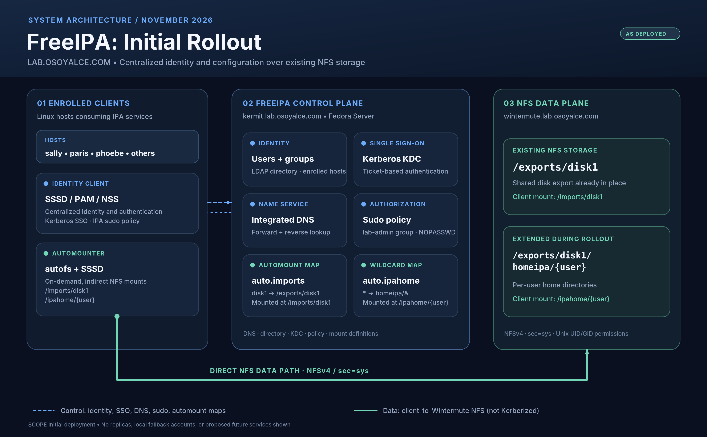
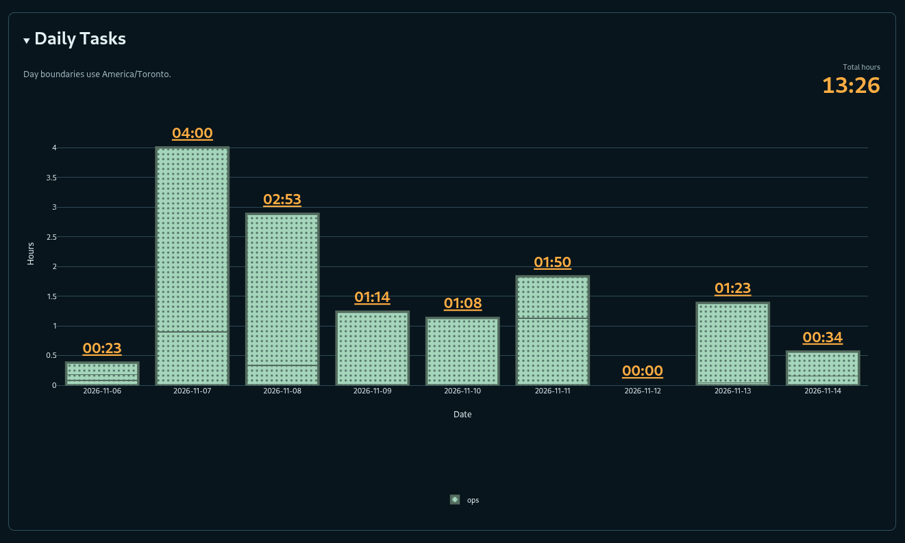
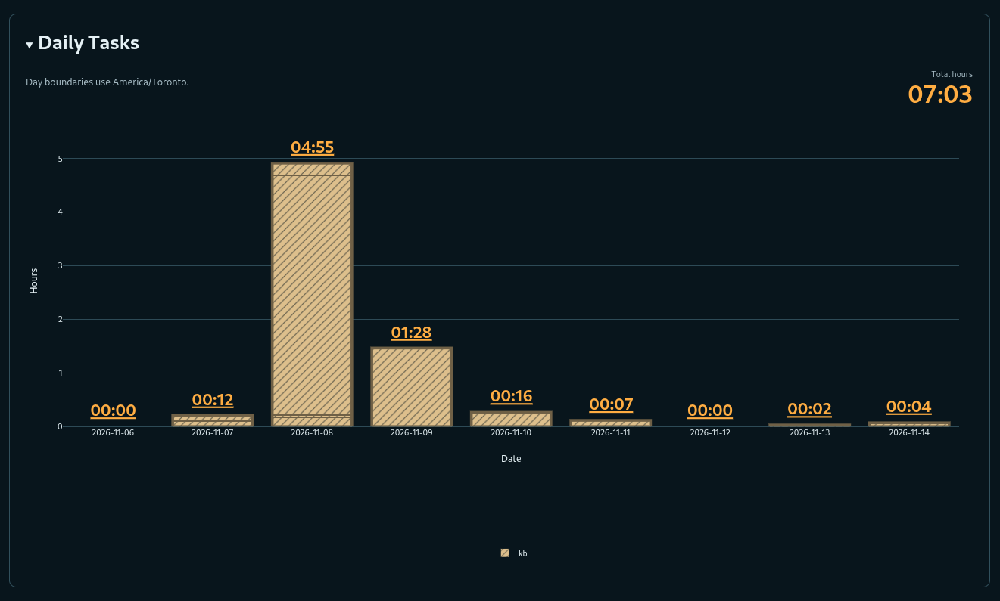
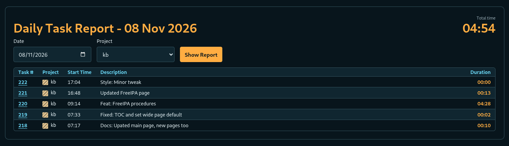

Я поступово розбудовую свою домашню лабораторію, і разом із нею доводиться розширювати обчислювальну інфраструктуру. Що це означає? Я не хочу витрачати дедалі більше часу на керування окремими машинами та обліковими записами. Мені потрібні централізований DNS, керування сертифікатами, єдиний вхід (SSO) та централізовано кероване автомонтування. Так я й знайшов [FreeIPA](https://ipa.show/).

**FreeIPA** робить усе, чого я хотів, і навіть більше. Причому на такому професійному рівні, що я без вагань розгорнув би його для одного зі своїх клієнтів із фінансового сектору. Це надійне й безпечне рішення, побудоване на добре відомих, перевірених часом технологіях, як-от Kerberos і LDAP. Якщо цікаво дізнатися більше, зазирніть до [цього довідника](https://ipa.show/reference/).



Утім, саме це й створило певну проблему. Коли шукаєш інформацію про FreeIPA, просто потопаєш у матеріалах. Їх надто багато, і більшість орієнтована на конкретний варіант розгортання. Зрештою я сам опублікував ще один схожий матеріал, коли задокументував власне [налаштування FreeIPA](https://kb.osoyalce.com/pages/FreeIPA/).

Але я таки розгорнув FreeIPA. Це зайняло певний час. [Звіт DevLog](https://devlog.osoyalce.com) показує роботу з *системного адміністрування*: чекання, перезавантаження машин, перевстановлення операційної системи й програм, помилки та повторні спроби.



Я також відстежував час на дослідження, розробку й документування.



Ось трохи більше подробиць.



## Висновок

FreeIPA просто чудовий. І, як на мене, вивчити його та виконати початкове розгортання приблизно за 20 годин — це хороший результат. Я **наполегливо** рекомендую його. А поки що просто насолоджуюся можливістю заглибитися в технічні тонкощі! 🤓

```sh
dan@sally:~$ ssh nadim@neuromancer

nadim@neuromancer:~$ hostname | tee freeipa.txt
neuromancer.lab.osoyalce.com
nadim@neuromancer:~$ exit

dan@sally:~$ ssh nadim@paris
nadim@paris:~$ cat freeipa.txt 
neuromancer.lab.osoyalce.com
nadim@paris:~$ hostname >> freeipa.txt 
nadim@paris:~$ df .
Filesystem                                                1K-blocks       Used  Available Use% Mounted on
wintermute.lab.osoyalce.com:/exports/disk1/homeipa/nadim 7751272448 5677623296 1682931712  78% /ipahome/nadim
nadim@paris:~$ exit

dan@sally:~$ ssh nadim@bingo
nadim@bingo:~$ cat freeipa.txt 
neuromancer.lab.osoyalce.com
paris.lab.osoyalce.com
nadim@bingo:~$ kinit
Password for nadim@LAB.OSOYALCE.COM: 
nadim@bingo:~$ klist
Ticket cache: KEYRING:persistent:1469600007:krb_ccache_M47oi5A
Default principal: nadim@LAB.OSOYALCE.COM

Valid starting       Expires              Service principal
2026-11-14 08:18:29  2026-11-15 07:41:55  krbtgt/LAB.OSOYALCE.COM@LAB.OSOYALCE.COM
nadim@bingo:~$ 
```
