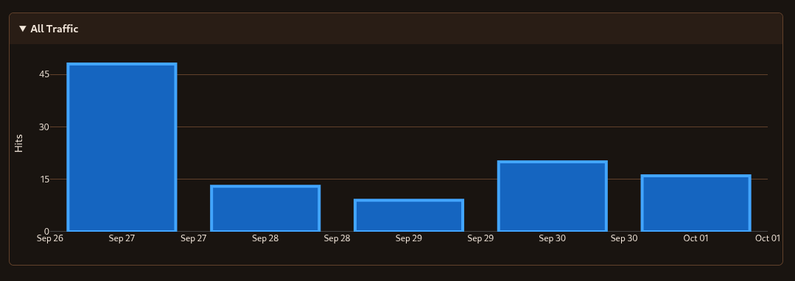
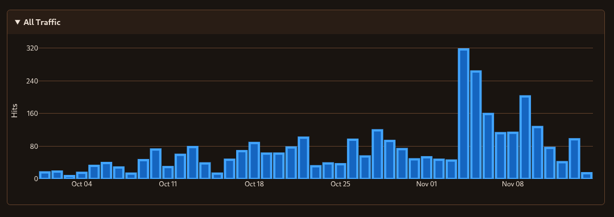
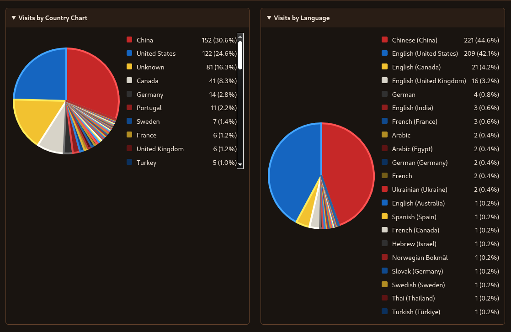
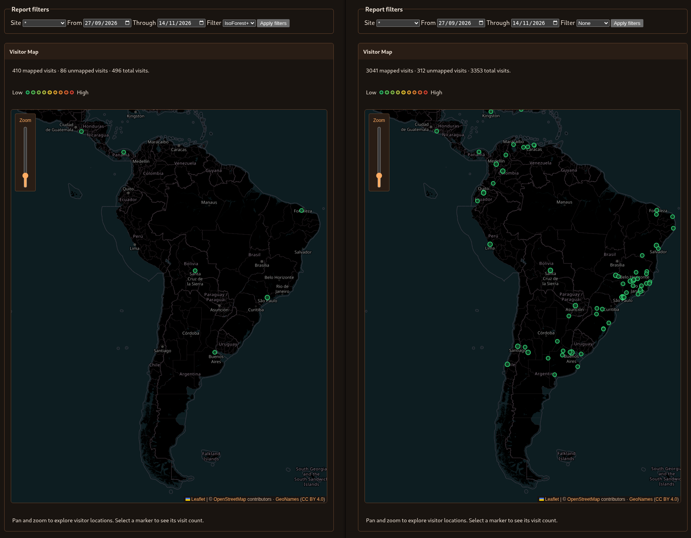
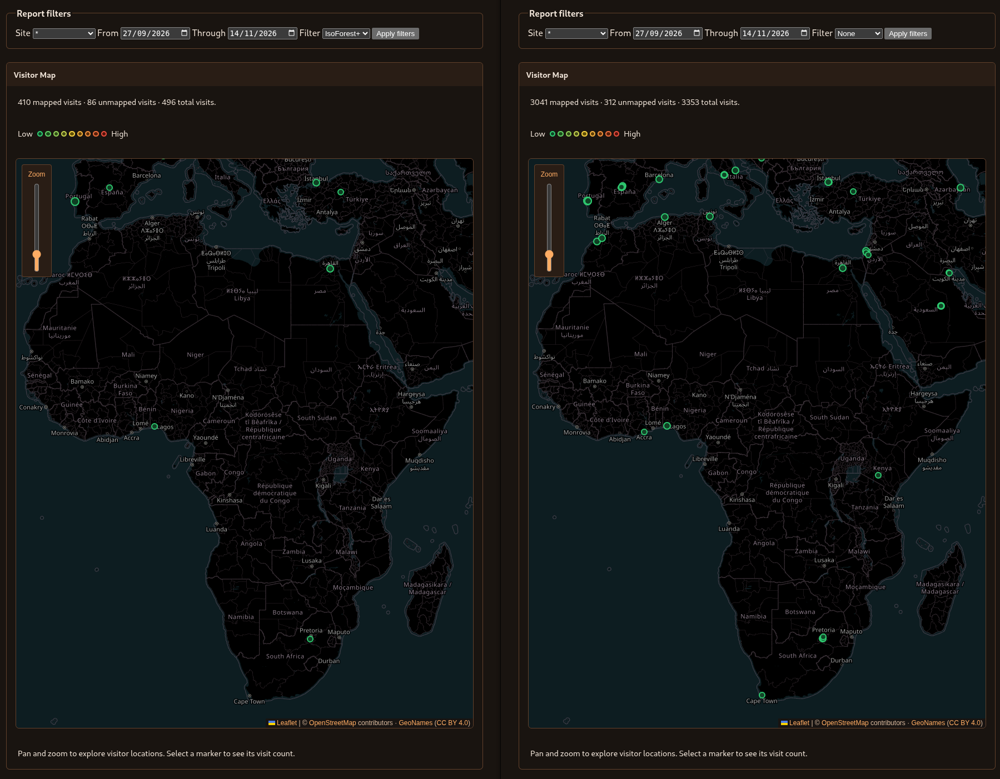
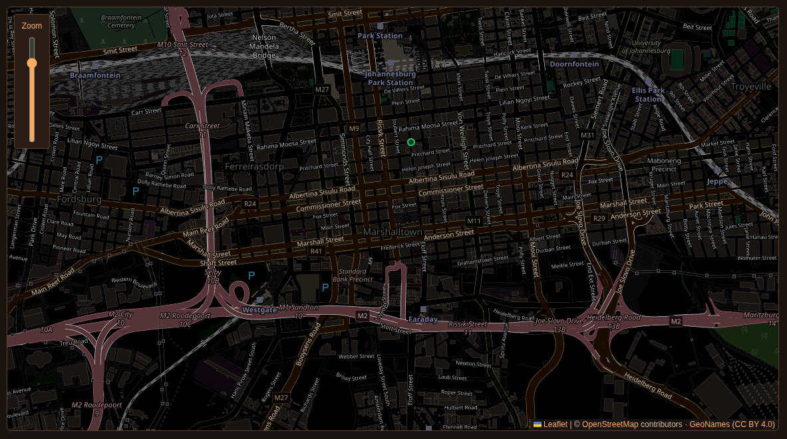

Майже 90 % трафіку на моїх сайтах надходить від ботів або краулерів! Я аналізую нібито *відвідувачів* вебсайтів у моєму домені [osoyalce.com](https://www.osoyalce.com). Деякі з них явно є ботами й самі про це повідомляють, але більшість цього не робить, а дехто навіть навмисно приховує свою ідентичність.

Коли я створював [MyCount](https://mycount.osoyalce.com), платформу вебаналітики, то хотів з'ясувати, чи цікавляться люди моїми проєктами з відкритим кодом і який обсяг відвідувань вони отримують. Я запустив MyCount 27 вересня 2026 року й відтоді додав інші сайти домену `osoyalce.com`. Ось знімок екрана з початку збирання даних.

На дані першого дня я майже не зважав. Коли щойно налаштовуєш систему, конвеєр обробки даних може працювати нестабільно, правда? Принаймні я себе в цьому переконував. Усе виглядало цілком нормально, аж поки не настав листопад:

Але це далеко не вся історія. Від самого початку я впровадив простий код для виявлення ботів. Потім трохи його підправив. Потім ще раз. І ще, і ще, і ще...

Версія | Дата | Зміна
--- | --- | ---
0.5.0 | 27 вер. | Початкова класифікація ботів
0.7.3 | 27 вер. | Виявлення Googlebot і GoogleOther
1.7.0 | 9 жов. | Додано Bytespider
2.1.0 | 17 жов. | Додано сигнатури HeadlessChrome, WebDriver та інших засобів автоматизації
2.7.0 | 25 жов. | Додано перевірки розбіжностей у рушії рендерингу, розмірі області перегляду та платформі
2.9.1 | 29 жов. | Додано виявлення скоординованих краулерів, що змінюють IP-адреси та ідентичності браузерів

Я також змінив схему бази даних на сервері, щоб полегшити аналіз.

Я навіть подумав про інтеграцію штучного інтелекту! Спробував локально запущену модель Qwen 3.5 4B. Це виявилося цілковитим провалом. Я навіть не впевнений, що така невелика модель здатна опрацювати настільки великий обсяг необроблених даних.

Я почав досліджувати проблему й виявив, що не сам із нею зіткнувся. Вона дуже поширена, існує вже давно й лише загострюється. Навіть у документації [Cloudflare](https://developers.cloudflare.com/bots/additional-configurations/block-ai-bots/) є окремий розділ про це!

Зрештою я зрозумів, що мої початкові очікування були хибними. Просто немає надійного способу визначити, чи справді по той бік з'єднання перебуває людина. Якщо заглибитися в журнали, можна побачити чіткі шаблони поведінки ботів і краулерів. Але тепер вони, схоже, намагаються приховатися?!?

- IP-адреси джерел змінюються.
- Заявлені географічні розташування підробляються.
- Сайти-джерела переходів теж підробляються.

Я знайшов [IsoForest](https://scikit-learn.org/stable/modules/generated/sklearn.ensemble.IsolationForest.html) у Scikit-learn, метод для виявлення аномалій у даних. Саме він виявився найкориснішим.

Версія | Дата | Зміна
--- | --- | ---
3.5.0 | 12 лист. | Початкова реалізація IsoForest із аналізом мережевих блоків та Isolation Forest
3.5.1 | 13 лист. | IsoForest+ став стандартним фільтром трафіку
3.5.2 | 13 лист. | Із інтерфейсу звітів прибрано повідомлення про запуск і посилання на розклад
3.5.3 | 13 лист. | Розширено виявлення за допомогою невідповідностей часових поясів, повторного використання шаблонів браузерів, варіацій області перегляду, узгодженості платформи та ознак переходів

Це не ідеально. А може, ідеально? Ні, усе-таки ні. Деякі цифри дивні. Подивіться на географію та мовні налаштування. Схоже, я доволі популярний у Китаї!

Коли починаєш аналізувати дані, іноді з'являються несподівані закономірності. Подивіться на трафік із Південної та Центральної Америки, відфільтрований за допомогою IsoForest. Історично в Південній Америці відбувалося чимало DDoS-атак, організованих бот-фермами. Мої сайти зараз не атакують, але видно, що в мій бік спрямовано чималу активність.

В Африці такого шаблону взагалі не спостерігається.

Що це означає? Важко сказати. Підозрюю, що Африка відстає за рівнем розвитку технологій і доступу до Інтернету, але це лише припущення.

З усього цього я зрозумів, що насправді не можу надійно відстежувати відвідувачів-людей і що майже 90 % трафіку моїх проєктів створюють боти й краулери. Та мені все одно подобається! Люблю наближати окремі місця й розглядати карти. Дивіться, ось цей візит із Південної Африки!

