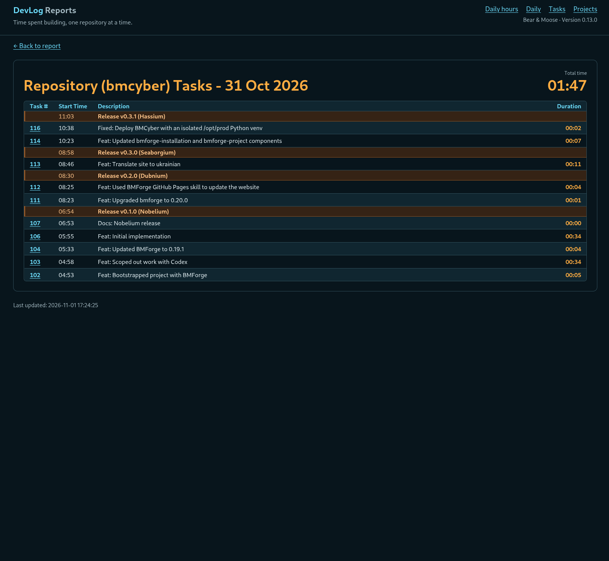

我开发了 [DevLog](https://devlog.osoyalce.com)，用来记录自己在开源项目上花了多少时间。我不想加入一大堆花哨的功能，只需要最基本的东西。下面就是我做出来的成果。

这是一款使用 ZeroMQ 进行消息通信的客户端/服务器应用程序。我在 Git 仓库中执行 `dl start`，就会向 DevLog 服务器发送一条消息。工作完成后，我执行 `dl commit` 并附上 Git 提交信息，程序会将更改提交到 Git，同时再向 DevLog 服务器发送一条消息。我还进一步加入了 `dl publish`，它基本上会完成一次 Git 版本发布，包括合并分支、处理功能分支等操作。

每个人使用 Git 的方式都不一样，所以这个应用是根据我自己的工作流程量身定制的。真正新增的命令只有 `dl start`。我用 `dl commit` 取代了以前的 `gitcommit` 快捷命令，并让 `dl publish` 调用以前的 `new-release.sh` 脚本。

这个应用很容易扩展，加入更多报表功能。不过目前它已经能满足我的全部需求。下面的截图展示了一天的工作记录。

下面这个视图只显示一个项目。

我偶尔会忘记执行 `dl start`，导致计时不准确。有时候也会忘记停止正在进行的任务。不过，当我在另一个仓库启动任务或执行 `dl pause` 时，系统会自动停止当前任务。因此，我还做了一个任务编辑器，可以手动调整任务的时间记录。

