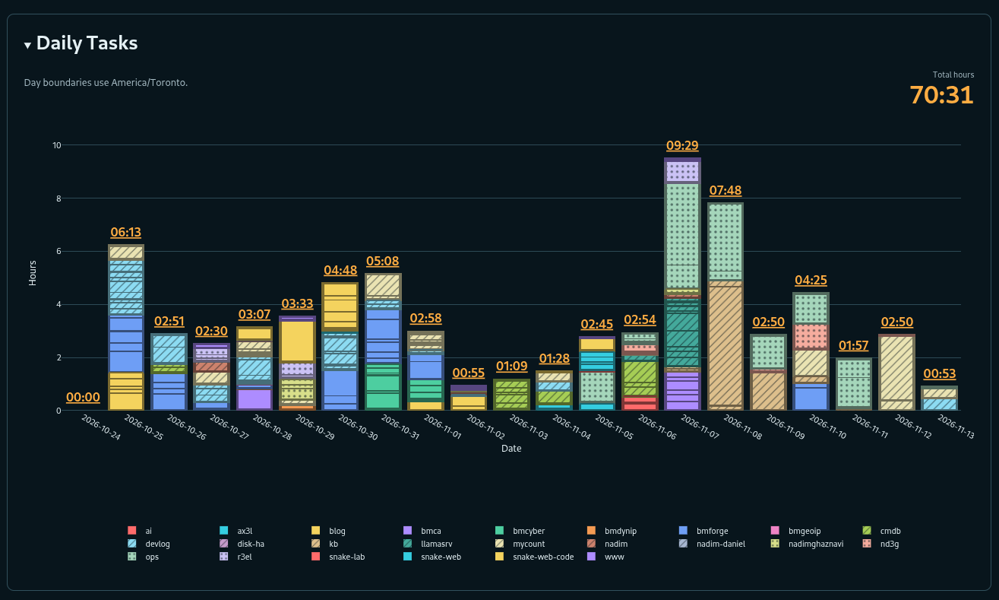

我想再写一篇后续文章，聊聊 [DevLog](https://devlog.osoyalce.com) 项目实际用起来怎么样。我差不多三个星期前部署了它，并开始每天使用。不得不说，我真的很喜欢它！



它不仅能让我一目了然地看到自己在各个开源项目上投入了多少时间，还能帮助我：

- 接着上次停下的地方继续工作。
- 更好地平衡生活与工作。
- 看清时间花在了哪里，以及究竟产出了什么（如果有的话）。

我还从中学到了一件事：并不是所有项目工作都会产生 GitHub 提交。例如：

- 营销宣传文章
- 验证工作
- 编写规格说明

为了记录这些工作，我创建了一个名为 **Ops** 的仓库。我用它来跟踪在实验室环境中部署 [FreeIPA](https://kb.osoyalce.com/pages/FreeIPA/#add-a-fedora-machine-to-the-freeipa-domain) 的过程。那可是一项不小的工程，我希望这些投入也能体现在 DevLog 的工时统计里。

此外，我还对 `dl status` 的输出做了一个小改动，现在它会显示已暂停的任务：

```
$ dl status
Repository (blog): Task #236 running for 00:17 (HH:MM)
Paused tasks:
  Repository (bmforge): Task #227 paused
$ 
```

总的来说，我对 [DevLog](https://devlog.osoyalce.com/) 非常满意。如果你也想追踪自己在 GitHub 项目以及其他工作上花费的时间，不妨去看看！如果你喜欢它，或者觉得它有意思，也欢迎给 [DevLog 的 GitHub 仓库](https://github.com/NadimGhaznavi/devlog) 点个 Star。
