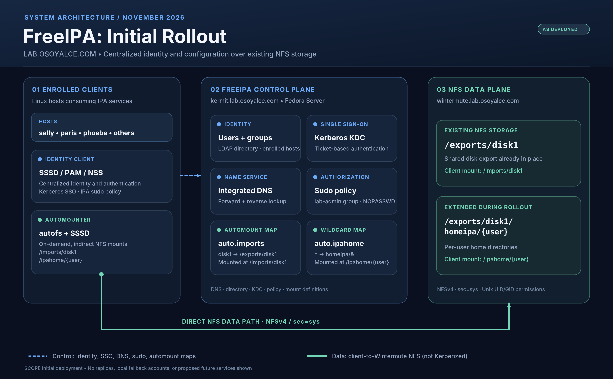
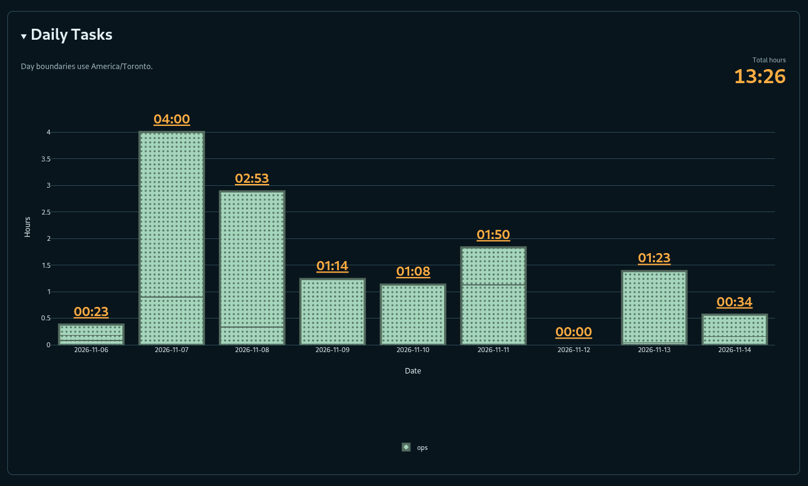
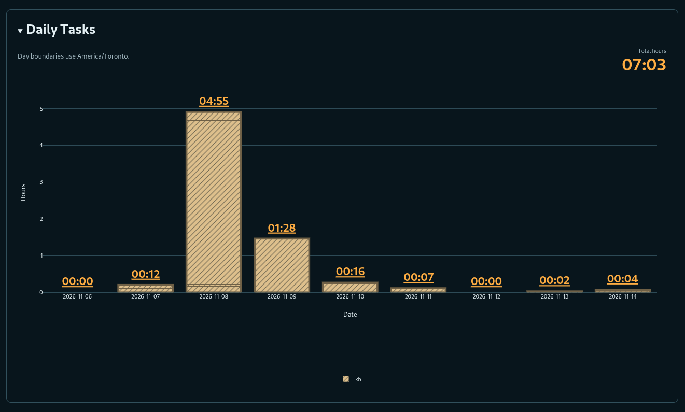
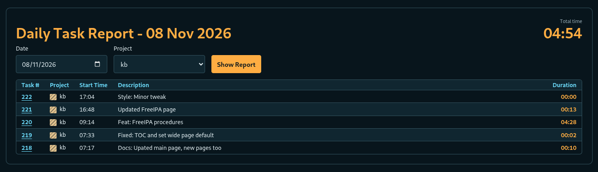

我的实验室正在一点一点扩展。随着规模不断增长，计算基础设施也得跟着升级。这意味着什么呢？我不想把越来越多的时间花在逐台维护机器、逐个管理账户上。我想要集中式 DNS、证书管理、单点登录，以及统一管理的自动挂载。于是我找到了 [FreeIPA](https://ipa.show/)。

**FreeIPA** 不仅满足了我的全部需求，还提供了更多功能。而且它达到了专业级的水准，让我有信心将它部署到金融行业客户的环境中。它稳定、安全，建立在 Kerberos 和 LDAP 这类大家熟悉、经过长期实践检验的技术之上。想进一步了解的话，可以看看[这份参考资料](https://ipa.show/reference/)。



不过，这也带来了一点麻烦。搜索 FreeIPA 时，各种资料会一下子涌过来，多得让人无从下手，而且大多数都针对某种特定的部署环境。最终，我在记录自己的 [FreeIPA 配置过程](https://kb.osoyalce.com/pages/FreeIPA/)时，也写出了一份类似的资料。

但我确实把它部署起来了，只是花了些时间。[DevLog 报表](https://devlog.osoyalce.com)记录了*系统管理*方面的工作：等机器、重启系统、重装操作系统和软件、折腾出问题，然后再来一遍。



我也记录了研发和编写文档所花的时间。



下面还有一些更详细的数据。



## 总结

FreeIPA 真是太棒了！在大约 20 小时里边学边做，完成第一次部署，我觉得这个成绩相当不错。我**强烈推荐**它。至于现在，我还沉浸在折腾技术的快乐之中！🤓

```sh
dan@sally:~$ ssh nadim@neuromancer

nadim@neuromancer:~$ hostname | tee freeipa.txt
neuromancer.lab.osoyalce.com
nadim@neuromancer:~$ exit

dan@sally:~$ ssh nadim@paris
nadim@paris:~$ cat freeipa.txt 
neuromancer.lab.osoyalce.com
nadim@paris:~$ hostname >> freeipa.txt 
nadim@paris:~$ df .
Filesystem                                                1K-blocks       Used  Available Use% Mounted on
wintermute.lab.osoyalce.com:/exports/disk1/homeipa/nadim 7751272448 5677623296 1682931712  78% /ipahome/nadim
nadim@paris:~$ exit

dan@sally:~$ ssh nadim@bingo
nadim@bingo:~$ cat freeipa.txt 
neuromancer.lab.osoyalce.com
paris.lab.osoyalce.com
nadim@bingo:~$ kinit
Password for nadim@LAB.OSOYALCE.COM: 
nadim@bingo:~$ klist
Ticket cache: KEYRING:persistent:1469600007:krb_ccache_M47oi5A
Default principal: nadim@LAB.OSOYALCE.COM

Valid starting       Expires              Service principal
2026-11-14 08:18:29  2026-11-15 07:41:55  krbtgt/LAB.OSOYALCE.COM@LAB.OSOYALCE.COM
nadim@bingo:~$ 
```
