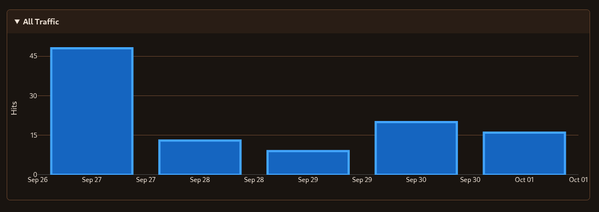
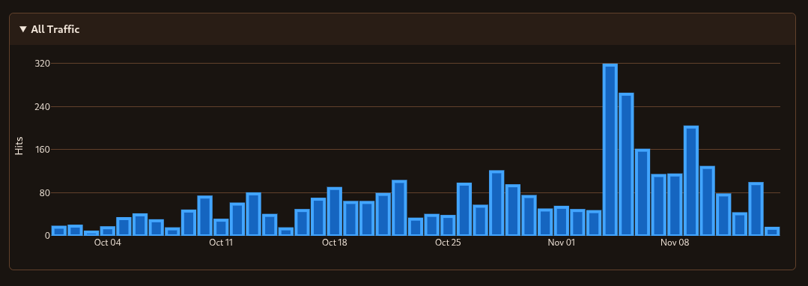
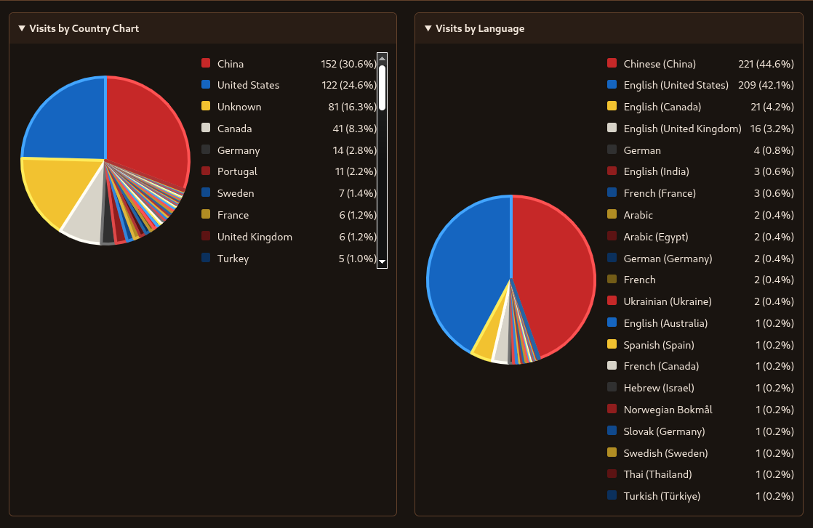
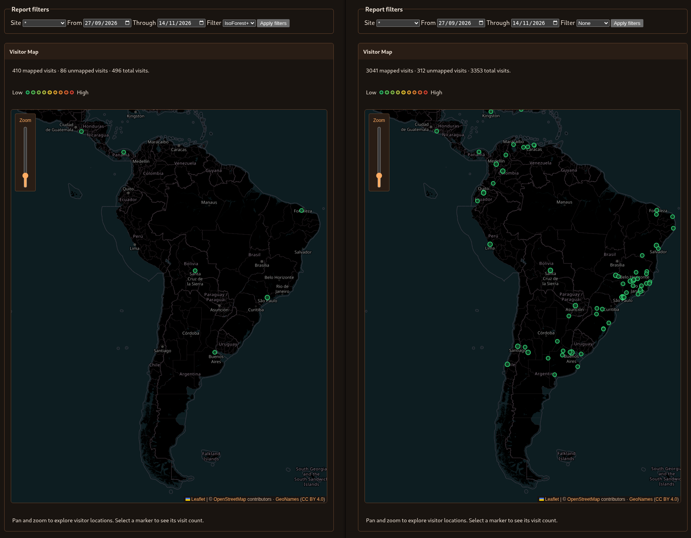
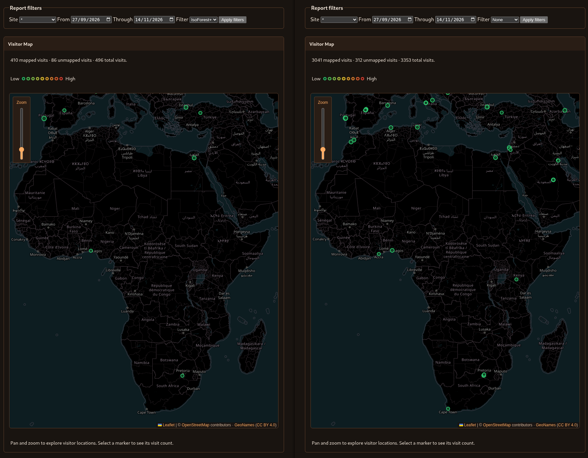
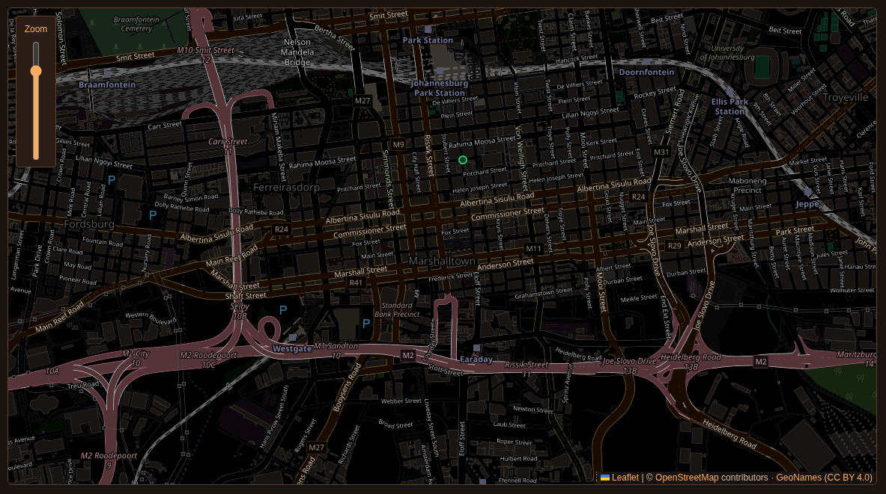

我的网站流量中，近 90% 竟然来自机器人或爬虫！我一直在研究 [osoyalce.com](https://www.osoyalce.com) 域名下各个网站的所谓*访客*。其中有些显然是机器人，也会主动表明身份，但大多数不会，有些甚至刻意隐藏自己的身份。

我创建网站分析平台 [MyCount](https://mycount.osoyalce.com)，最初只是想看看有没有人在关注我的开源项目，以及访问量究竟有多大。MyCount 于 2026 年 9 月 27 日上线，此后我又陆续接入了更多 `osoyalce.com` 网站。下面这张截图展示了从开始收集数据以来的流量。

起初我没把第一天那组异常的数据当回事。毕竟系统刚搭起来，数据处理流程偶尔不稳定也很正常，对吧？至少我是这么安慰自己的。直到 11 月之前，一切看起来都挺正常：

可事情远不止这么简单。真的差远了。从一开始，我就部署了一套简单的机器人检测代码。然后改了一次。又改了一次。再改，再改，再改……

版本 | 日期 | 变更
--- | --- | ---
0.5.0 | 9 月 27 日 | 初版机器人分类
0.7.3 | 9 月 27 日 | 增加 Googlebot 和 GoogleOther 检测
1.7.0 | 10 月 9 日 | 增加 Bytespider 检测
2.1.0 | 10 月 17 日 | 增加 HeadlessChrome、WebDriver 及其他自动化工具特征检测
2.7.0 | 10 月 25 日 | 增加渲染器、视口及平台信息不一致检查
2.9.1 | 10 月 29 日 | 增加针对不断轮换 IP 地址和浏览器身份的协同爬虫检测

为了让分析更方便，我还修改了后端数据库的结构。

我甚至考虑过引入人工智能！我试过在本地运行 Qwen 3.5 4B，结果彻底失败了。我都不确定这么小的模型能否处理如此大量的原始数据。

后来我开始查资料，发现遇到这个问题的远不止我一个人。这种情况相当普遍，有报道[将它与字节跳动（ByteDance）联系起来](https://mashable.com/article/tiktok-parent-company-bytedance-web-crawler-25-times-faster-than-openai)。从更广的角度看，这个问题由来已久，而且越来越严重。[Cloudflare](https://developers.cloudflare.com/bots/additional-configurations/block-ai-bots/) 甚至在文档中专门设了一个章节讨论它！

最终我意识到，自己最初的预期就不太现实。实际上，根本没有一种可靠的方法能判断连接另一端到底是不是人。深入查看日志时，确实能够发现机器人和爬虫非常明显的行为模式。但现在它们似乎还在设法隐藏自己？！？

- 来源 IP 地址不断变化。
- 上报的地理位置可能是伪造的。
- 引荐来源网站也可能被伪造。

后来，我发现了 Scikit-learn 的 [IsoForest](https://scikit-learn.org/stable/modules/generated/sklearn.ensemble.IsolationForest.html)，一种用于发现数据异常的算法。结果证明，这是最有用的方法。

版本 | 日期 | 变更
--- | --- | ---
3.5.0 | 11 月 12 日 | 初步实现 IsoForest，结合网段分析与 Isolation Forest
3.5.1 | 11 月 13 日 | 将 IsoForest+ 设为默认流量过滤器
3.5.2 | 11 月 13 日 | 从报表界面移除运行提示和计划任务链接
3.5.3 | 11 月 13 日 | 增加时区差异、浏览器模板复用、视口变化、平台一致性和引荐来源特征检测

它并不完美。还是说，它其实很完美？不，当然不是。有些数据挺古怪的。看看访问地点和语言设置吧。我在中国似乎相当受欢迎！

开始分析数据后，有时会发现一些意想不到的规律。看看经过 IsoForest 过滤后，来自南美洲和中美洲的流量吧。从历史上看，南美洲的机器人集群曾发起过不少 DDoS 攻击。我的网站并没有遭到攻击，但可以看出，确实有大量活动指向我的网站。

非洲完全没有表现出同样的模式。

这意味着什么呢？很难说。我猜可能与非洲在技术发展和互联网接入方面相对滞后有关，但这仅仅是我的猜测。

这次经历让我明白，我其实无法可靠地追踪真正的人类访客，而且我的项目收到的流量中，近 90% 都来自机器人和爬虫。可我还是很喜欢这个工具！我喜欢放大地图，看看访问来自哪些地方。瞧，这次访问来自南非！

